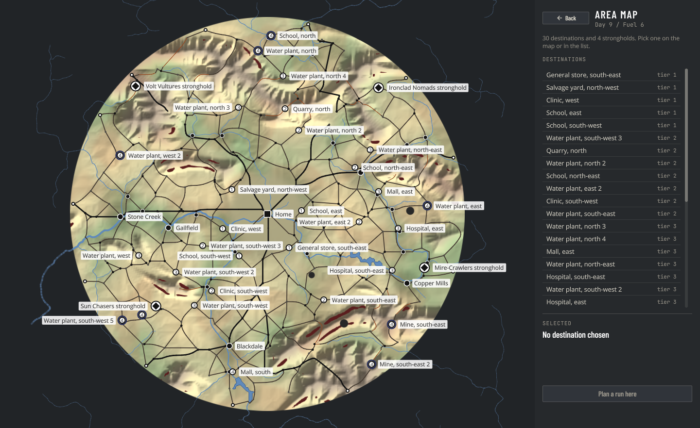
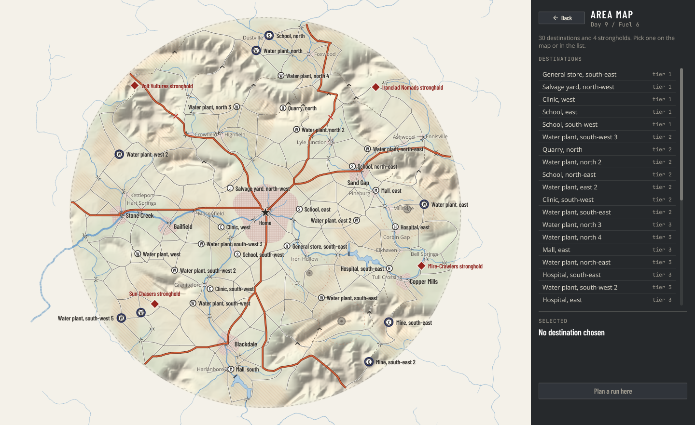
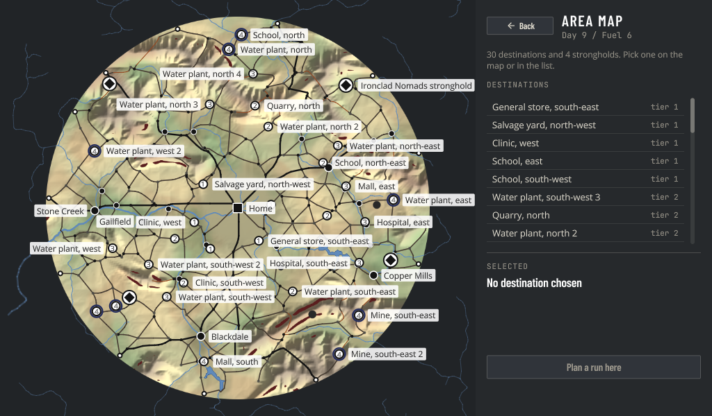
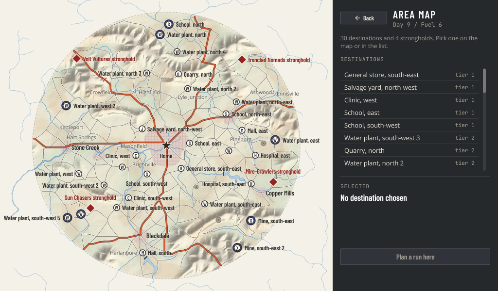
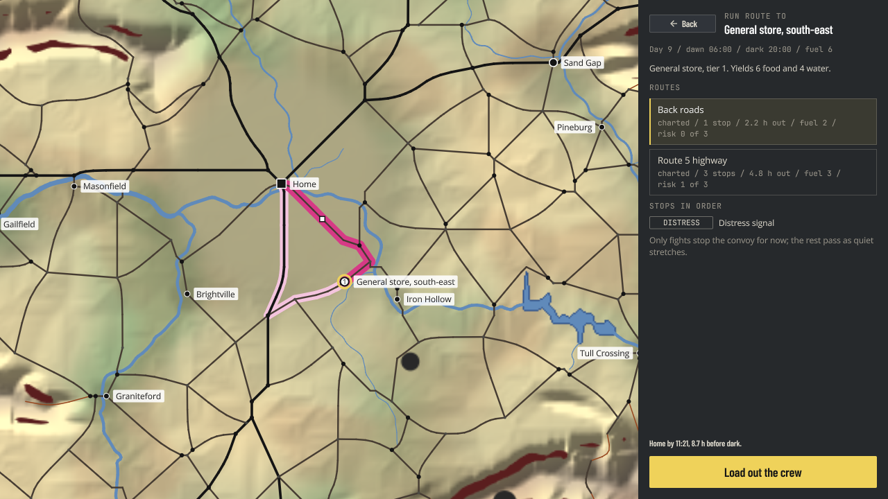
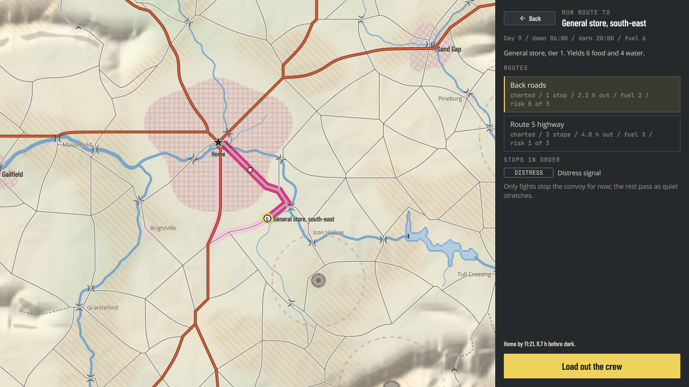

# The area map as a road atlas, on what the map already has

## Date
2026-10-16

## Context

The area map, the run route screen, and the gallery scenes draw the generated map through one component, `AreaMapView`, over a terrain bake (area-map-view.md). Until now they drew it functionally: saturated yellow-khaki land, hard dark-red cliff streaks, every road class a thin dark line, a dark background past the disc, towns as black dots, POI names in white boxes, POIs as numbered tier badges, and the compound as a black square.

The target is Area Map Generation's "Rendering: the road atlas" and Decision 4 of realistic-map.md, with the renders in `docs/design/realistic-map/` (mixed-seed-7.png first). This change restyles everything the map already carries. The dressing's output (street grids with missing blocks, rail, river and range and pass names, highway shields) waits on the dressing stage and comes after it; so do the lettered side-by-side route bands and a finer close-zoom bake.

Constraints: one uber shader, no new pipeline; style constants in `areaMapStyle.ts`; the land bakes once a map, everything else draws live; the 1024x600 layout lint-clean; frame time smooth.

## Before and after

| | Before | After |
| --- | --- | --- |
| Area map, 1440x882 |  |  |
| Area map, 1024x600 |  |  |
| Run route, 1280x720 |  |  |

The gallery's fog scene, with stand-in knowledge, every marker state, and a metro name: `../design/area-map-atlas-style/after-area-map-fog.png`.

## Decisions

### The bake

- Land colour stays a continuous blend of moisture and elevation (`landColour`), retuned light and muted: buff, pale khaki, and sage by moisture, warming toward a grey-brown in high country. The target's land sits around (228, 226, 206), its shadows near 0.6 of that and its highlights near white, and the palette was set against a histogram of it.
- Hill shade is read from the slope lattice bicubic (Catmull-Rom, a texel row at a time, then along it), so the land grid's cells never facet. The slope toward the light goes through `tanh`, so the steepest ground saturates instead of clipping, and is scaled by a relief strength from `low` on flat country to `high` in the ranges, carried on the colour lattice. The lit side is scaled down by `light`: lit slopes that brightened as much as shadowed ones darken clipped to white.
- Cliffs are a soft scarp shade, a third of the way to a grey-brown, rather than a solid band; the hill shade already draws the slope, and a solid band read as a wall of paint.
- Contamination tints the land toward a warm rust and is hatched with thin diagonal lines in world space, from none at 0.4 to 0.28 strength at 0.95. A third to a half of most maps is contaminated (the noise field, not only the plumes), so anything stronger swamps the page.
- Craters are drawn as craters: a dark rim, a lighter floor, a dark core. Each plume's edge is a dashed rust ring, the "blast zone" circle of the target without its label.
- Towns and villages are built-up patches baked from `ruinsOf(places)`: a flat pale-brick fill inside a ragged edge (two sine waves round the radius), the metro and towns with a street grid turned by each place's own angle, villages plain. Edge phase and turn come from a hash of the place's position, so a map bakes the same bytes every time. This replaces the old darkening under ruins.
- Lakes keep their depth-field fill and darker shore, in the atlas's blues.
- The rim: the last 2.5% of the radius fades toward paper, and a dashed grey line runs just inside the edge. Texels past the rim stay transparent, so the view's paper shows there.

### Outside the disc

The view's ground is the paper colour. Rivers past the rim are still drawn, faint, as they were. The bake was not extended past the disc: the target shows paper and rivers out there, not faded land, and a wider bake would cost about a third more texels for nothing on screen. The side panels are separate components and keep the game's dark UI.

### Roads

Each class draws its casings under its fills, trails then back roads then highways, so a highway's dark casing runs over the back roads it meets and the junctions read as one line. Highways are an orange-red fill in a dark casing, back roads a thin grey on a pale edge, trails thin and dashed along their whole length. Rumored roads mix fill and casing toward paper, still opaque; uncharted stubs are fading dashes in the class's fill, as before. Junction dots are gone, with the layer toggle: round caps already join the lines, and the atlas has none.

- Bridges: two parapets either side of each deck (`stretch.bridges`, sliced from the polyline), just outside the road's widest line, flared out at both ends.
- Collapsed spans (`network.broken`): casing and fill either side of a gap at the span's middle, with a red cross over the gap. Hidden where its middle is fogged.
- Passes (`network.passes`): a dark chevron. Labels come with the dressing.
- Dams: a dark bar square across the river at each reservoir's outlet, from `water.lakes`, which the view now gets as `AreaMapData.dams`.

### Places and labels

Towns and villages no longer draw dots; their patches are in the bake and their names sit beside them. Crossroads and exits draw nothing. The metro's name is set in spaced capitals above Home when the map has one (`AreaMapData.metroName`). Nothing names the metro yet, so the game's maps show none until the dressing does; the gallery passes a stand-in.

Every label is dark type on a paper halo, the blurred shadow run the text path already has (R6.6) in paper at zero offset, so no shader change. Labels are placed by priority through `LabelLayout` (mapLabels.ts): Home's star, the picked route's stops, and every marker are blocked first; then Home's label, the markers' labels in priority order (the selected one placed whatever's there if it has no clear spot), the metro's name, towns biggest first, then villages. Each tries right, left, above, then below its symbol, inside the view and clear of everything already placed by a 1.5 px pad, and is dropped when none fits. The village zoom gate is gone: decluttering decides.

### Gameplay on top

- POIs are circled glyphs by type: a letter in the condensed bold face (`POI_GLYPHS`), ink while unvisited, grey once looted, paper on a grey disc and struck through once depleted. Markers carry `type` instead of `badge`, so the tier numbers leave the map; the destinations list and the run route panel still show tiers.
- Strongholds are red diamonds on a paper edge, their names in the same red.
- Home is a five-pointed star in ink on a paper halo.
- Night rings and the selection ring are kept.

Route bands are unchanged here: lettered side-by-side bands are later work.

### Bridges and passes are zoom-gated

From 0.3 screen pixels a world unit in. A 1600-radius map fitted whole sits near 0.17, where every river crossing's parapets crowd out the roads; the game's maps sit around 0.4 and show them.

## Options considered

- Halos: an outline term in the uber shader's text mode (crisper, but a shader and command change for one consumer) or the existing blurred shadow run in paper. Took the shadow run; at 2.2 px it reads as a halo on the light page.
- POI glyphs: Material icons from the icon atlas (needs new glyphs, which needs `msdf-atlas-gen`, not on this machine), vector pictograms (a dozen hand-drawn shapes, more draws a marker), or letters. Took letters, which is also what the target renders show, one per type and unique case-insensitively.
- Built-up patches live (polygons per place, a draw each, retriangulated per edge) or baked. Baked: they're land, they never change, and the street grid would be hundreds of lines live.
- Paper outside the disc: extend the bake past the rim and fade it, or leave the bake transparent there over a paper ground. The latter, as above.
- Label candidates: two sides (as before), four, or eight. Four: two drop a label wherever both sides of its symbol are crowded though above or below is often clear, and the diagonals can wait until a crowded map shows they're needed.

## Visual calls

Calls the target doesn't settle, made here and listed for Kevin:

1. Land palette: dry (235, 229, 207), middling (229, 228, 209), wet (214, 221, 199), high ground (212, 204, 188) from elevation 0.15 to 0.6, because the target's land histogram centres there.
2. Hill shade: gain 140 into a tanh, relief 0.16 on flat land to 0.4 in the ranges, lit side at 0.4 of the shadow side, because shadows at 0.6 of the land and highlights just short of white match the target.
3. Cliffs a 32% grey-brown shade, because a solid band read as paint over relief the hill shade already shows.
4. Contamination hatch: lines 12 units apart, 1.4 wide, up to 28% rust, because a third or more of most maps is contaminated.
5. Built-up fill (229, 212, 204) with streets every 11 units, edges 18% ragged, villages without streets.
6. Highway fill (216, 96, 54) in a (104, 44, 30) casing, 2.4 and 4.2 px; back roads (118, 114, 106) at 1.1 px on a near-paper edge 2.7 px wide; trails dashed 4 on 3.
7. Bridges as flared parapets, collapsed spans as a 9 px gap under a red cross, passes as a chevron, dams as a dark bar across the river.
8. Bridges and passes drawn from 0.3 px a unit in.
9. POI glyph letters: hospital H, clinic C, school S, store G, mall M, water plant W, fuel depot F, truck stop T, quarry Q, mine X, farm B, silo O, salvage yard J.
10. Labels: towns, POIs, strongholds, and Home in the condensed bold face at 14 and 13 px, villages in the body face at 10.5 px, the metro at 17 px with 0.16 em spacing; halo a 2.2 px paper blur.
11. Tier badges off the map; tiers stay in the lists.

## Measurements

Bake, `node scripts/area-map-bake-bench.mjs --seeds 3 --repeat 5` (Node 24, the five environments, the fastest of five runs each, main and this branch back to back). The bench now bakes what the view bakes, the land with its water and hazards and the places' ruins, and finds its modules by following imports, since its hand list had gone stale.

| Radius | Texels | Before median | After median |
| --- | --- | --- | --- |
| 600 | 480 | 28.0 ms | 32.5 ms |
| 1000 | 800 | 75.0 ms | 86.1 ms |
| 1600 | 1024 | 130.1 ms | 140.4 ms |

About 15% more at the common radius, for the hatch, the patches, the craters, and the bicubic read. A first cut was 55% more; a plume test per texel was most of it, and testing only the hotspots whose plumes reach the row brought it back.

Frame, `scripts/perf-capture.mjs` on the gallery scenes at 1440x882, unthrottled (perf-results/ddb-498-before.md and ddb-498-after.md):

| Scene | Before median / p99 | After median / p99 | API draws | Triangles |
| --- | --- | --- | --- | --- |
| area-map (radius 1600, whole) | 2.89 / 5.47 ms | 4.92 / 6.80 ms | 2304 -> 3036 | 10440 -> 18414 |
| area-map-fog (radius 1000) | 1.03 / 1.75 ms | 1.16 / 1.71 ms | 364 -> 465 | 4160 -> 5174 |

The cost is the casings, a second line under every back road and highway, on the largest map at its widest. It stays one GPU draw a frame.

## Carried over from the view's first PR

- #176's QA probes are tests now: a click pressed inside and released outside the box selects nothing; drawn and self-culled road groups add up wherever the camera is, a group a dash for a stub; dashes are rebuilt only when the zoom crosses one of `DASH_ZOOM_STEPS`; `0` calls `restoreFit` and returns to a framed rect; and the zero-area guards hold at zooms under 0.75.
- The gallery hands a scene the height it leaves it (`fillHeight`, not `height`, which the sections that pass their options to their frame would take as fixed). The area map scenes fill it, so they lint clean at 1024x600 and 640x480, and both are linted at the short size now.
- The area map scenes were already in `SCENE_SCENARIOS`, so the electron shell spec has goldens for them.

## Consequences

- `MapMarker.badge` is gone; markers carry `type`. `AreaMapData` gains `dams` and `metroName`. The `junctions` layer toggle and `PLACE_STYLE` are gone.
- Text halos double the label text runs (a shadow run before each).
- The bake is about 15% slower at the common radius and still runs once a map.
- When the dressing lands, its street grids replace the patches' plain grids, and its labels go through `LabelLayout` after the places' names.
