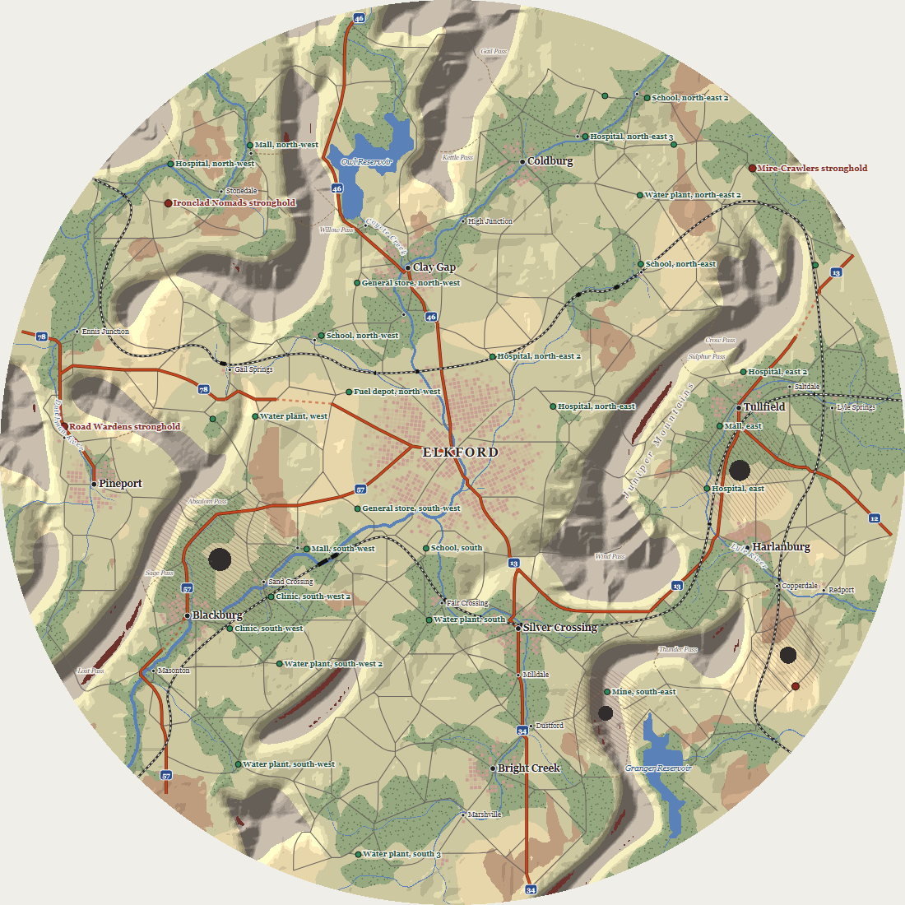
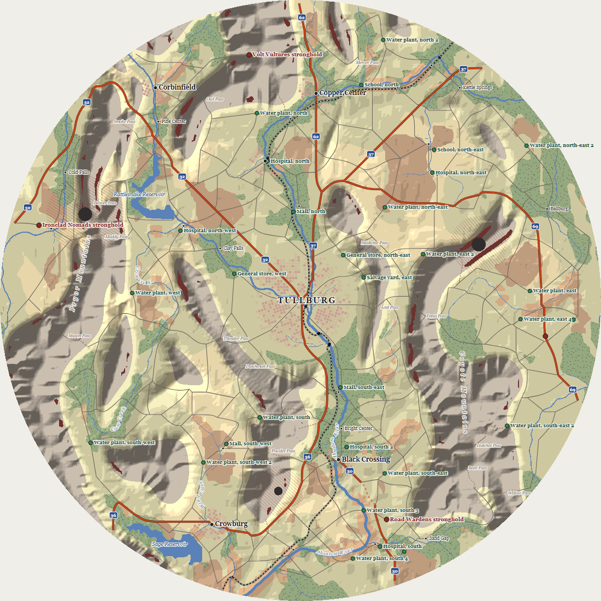
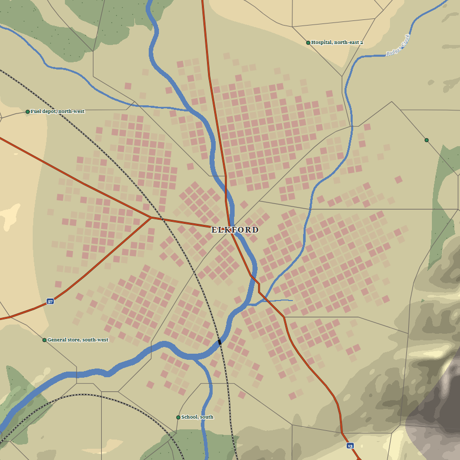

# The dressing stage

Date: 2026-10-16. Code: `_legacy/src/renderer/game/map/` (`Dressing.ts`, the stage's output and its hatching, stipple, and route numbers; `StreetGrids.ts`; `RailLines.ts`; `MapLabels.ts`, label candidates and the land's named features; `PlaceNames.ts`, feature roots; `NodeHeap.ts`, moved out of `RouteTree.ts` for the rail search), wired in `AreaMapPipeline.ts` (`DRESSING_STAGE`), carried by `worker/mapGenerationProtocol.ts`, timed and drawn by `_legacy/scripts/road-network.mjs dressing` and `bench`. Spec: [Area Map Generation](../specs/Area%20Map%20Generation.md), 11. Dressing, Saving, Seeds and determinism, and Guarantee 9. Builds Map 15 of [realistic-map.md](./realistic-map.md) over the places of [places.md](./places.md) and the roads of [road-network.md](./road-network.md), on the runner of [map-pipeline-worker.md](./map-pipeline-worker.md).

## Context

The spec's last stage dresses the map so it reads as a page of a road atlas: street grids for the ruined towns and the metro, rail lines, contamination hatching and mire stipple, and labels. It carries no gameplay. It reads every stage before it, writes nothing back, isn't saved, and a load makes it again from the seed, the params, and the saved map; removing all of it changes no gameplay data (Guarantee 9).

The item's first description had county roads, farm tracks, and broken highways in the dressing. Maps 7 and 8 made back roads, trails, and broken highway spans real roads, so the dressing keeps to the spec's four parts.

This stage generates; it draws nothing. Drawing it in the atlas style comes with the view's restyle.

Rust Belt seed 11 and Mixed seed 7 at radius 1000, and Rust Belt 11's metro close up, drawn by `node _legacy/scripts/road-network.mjs dressing`. The labels there are set by the script's own greedy placement, not the view's:







## The stage, and saves made before it

`dressing` runs last, on `root.fork('map', m)` ... `.fork('stops', s).fork('dressing', d)`, and forks every part from that by name: `routes`, `names` (with `metro` and `features` under it), `rails`, `grids` (with `ruin` at each place's id, and `district` at each district's index under that), `hatches`, and `stipple`. A part never draws from another's fork, so laying a rail more or less never moves a block, and a town's grid never depends on another town's.

Options for fitting it to saves:

1. A stage like any other, with a generator version bump. A save names its stages' attempts and the runner refuses a replay missing one, so adding a stage meant bumping `AREA_MAP_GENERATOR_VERSION`, and the store would read every save made today as outdated. That breaks "old saves load" for a stage that can't change play.
2. Not a stage at all: a function run after the pipeline on the stops' winning stream. It loses the runner's timings, progress, and local retries, and the spec calls the dressing stage 11 of the pipeline, a link in the stream chain like any other.
3. A stage the runner knows is inert (chosen). `MapStage.inert` marks a stage that carries no gameplay. The builder holds it to two rules: it retries only itself (`localRetry`), since a map restart would move the gameplay map, and no gameplay stage may follow it, so nothing play reads can depend on it. A replay whose attempts leave an inert stage out runs it on its first attempt. So a save made before the dressing existed replays exactly as it did, gameplay and all, with the dressing's first attempt, and the dressing needs no version bump of its own. The pinned stage list (`CampaignMaps.test.ts`) pins the inert stages too, and `GeneratorVersion.ts` says an inert stage never bumps it.

The stage has no checks, so its first attempt always wins and a save's `mapAttempts.stages.dressing` is always 0 today. It keeps the attempt anyway, so a check added later (the validator's "dressing touches nothing") can reject an attempt without moving saves that already won theirs. A change to what the dressing makes needs no version bump either: like the land's shading under the saved lines, it only changes the picture.

## The data: what the view draws

```ts
interface Dressing {
	readonly districts: readonly StreetDistrict[];  // the metro's districts first, then towns', then villages'
	readonly rails: readonly RailLine[];
	readonly hatches: readonly HatchRegion[];
	readonly stipple: Float64Array;                 // mire dots, x, y per dot
	readonly metroName: string;                     // "Elkford"; its label is in capitals
	readonly routeNumbers: readonly number[];       // by RoadStretch.highway, from 0
	readonly ranges: readonly MapRange[];           // { name, cells, x, y, ux, uy }
	readonly labels: readonly MapLabel[];           // highest priority first
}
interface StreetDistrict { place; kind: 'metro' | 'town' | 'village'; x; y; ux; uy; spacing; blocks: Float64Array; rubble: Float64Array }
interface RailLine { points: readonly number[]; length; bridges: readonly RoadBridge[] }
interface HatchRegion { x; y; inner; outer; ux; uy; spacing }
interface MapLabel { kind; text; priority; x; y; path: readonly number[]; ref }
```

All world units, the compound at the origin, frozen. A district's blocks are squares `spacing` across centred on each `blocks` and `rubble` point, sides along (ux, uy) and (-uy, ux); the street between blocks is the view's to choose. `x, y` is a block corner. A rail's bridges are decks as distances along its line, like a road's. A hatch region is the annulus from `inner` (the crater's rim) to `outer`, lined along (ux, uy) every `spacing`. The typed arrays transfer from the worker with the rest of the map's; `freezeDressing` refreezes the rest after the crossing.

## Street grids

Each town and village gets one grid at a drawn rotation, centred on the place; the metro gets several districts. Every block's centre runs out to the ruin's radius, with an edge drawn per block between 0.85 and 1.15 of it so it's ragged. A block is kept only where its centre and corners are clear of water, craters, and cliffs, no river's water lies within half a block of its centre, and no road, collapsed highway span, or rail runs through it: each segment is walked block by block (Amanatides and Woo), so a line that clips a corner still makes the block street. The rails are laid first for that. A kept block stands with the survival odds, or is rubble.

- Spacing 14 world units at `streetGrids` 0 to 8 at 1, 9.8 at the default 0.7.
- Survival 0.3 at `streetGrids` 0 to 0.9 at 1, times one less 0.6 of the square of the block's share of the way to the edge.
- Metro districts: 2 plus one per 50 units of the radius the grids cover, at most 7: 5 at the default metro of 150 and the default dressing, fewer below it. The first sits within 0.15 of the radius of the middle, the rest 0.45 to 0.8 out, evenly round and jittered by a quarter of the gap. A block corner belongs to the district whose seed is nearest by 2 units or more, so neighbouring grids stop short of the line between them and their streets meet along it, the old district line.
- District angles: spread evenly over a quarter turn from a drawn angle, in a shuffled order, each jittered by a quarter step, so any two differ by at least half a step (9 degrees for five). A first cut drew each angle and redrew within 15 degrees of another; five districts can't all keep 15 degrees apart in a quarter turn, and two came out 0.2 degrees apart.

Rust Belt 11 at radius 1000: 38 districts, 865 blocks standing and 717 rubble.

## Rail lines

`railLines` lays `railLines` lines, fewer where the land leaves no way across, each from the rim to the rim. It searches a grid two land cells to one (about 19 units a cell) by A*:

- A coarse cell is open where nothing a rail can't cross (a lake, a crater, a cliff) stands at its centre or at the centres of the four land cells under it, so a step between two open cells seldom clips one.
- A move costs its length times one plus 400 times its grade squared, times one plus 1.5 times how far it stands above the low ground (the water's lowland, 1 on a valley floor), plus 4 times the range mask times its length, plus 40 units for each end on a river cell, any land cell of the four under it carrying the stream threshold's drainage. Lakes, craters, and cliffs are closed, and a diagonal needs both cells beside it open. So lines take valley floors and gentle grades, and cross a river rather than running along it; a first cut, charging 6 for a river cell at its centre only, ran a line down the river with a 60-unit "bridge".
- Line k's first end is at a bearing spread evenly round half the rim from a drawn one, the second 140 to 220 degrees round from it (115 to 245 once a retry has turned the first). The search runs from any open cell just inside the rim within 25 degrees of the first bearing to any within 25 of the second, and the line runs on to the rim beyond the cells it took. A first cut fixed each end at the lowest ground in its window, and the line hooked back to reach it: Mixed 8 lost its only line to that.
- A line keeps 6 cells off an earlier one by costing six times as much there; it can still cross. At twice, QA found two lines braiding down one valley on Rust Belt 11 (486 units within 30 of each other).
- Past 0.88 of the radius a move costs four times as much, so a line crosses the rim at its ends rather than running round it; without it, High Desert 3's line ran 1,135 of its 2,997 units along the rim.
- A line is dropped and drawn again, up to six tries in all, where it finds no way, where it doubles back (its heading, read every 20 units, turns more than about 150 degrees, a cosine under -0.85, within 200 units), or where it runs within 30 units of an earlier line for more than 300. Each try draws the second end afresh and, after the first, turns the first up to 25 degrees either way; the last goes without the rim cost, since the rim cost can leave a line no way across but back on itself. Over 30 maps at the defaults (five environments by seeds 21 to 26) every line asked for was laid; at three lines, High Desert 44 lays two.
- The cells are simplified by Douglas-Peucker at 2 cells and cut by Chaikin four times. Where that clips a lake, crater, or cliff (sampled every unit) or lays a deck over 30 units, tolerances of 1 and 0.5 cells are tried, then the cells themselves.
- Bridges are where the line's samples fall in river water, merged across gaps of 2 units or less.

A rail is never a road: it's in no network, nothing routes or places stops on it, and the view draws it with the rail pattern.

## Hatching and stipple

Every crater inside the disc whose plume is stronger than 0.15 is hatched from its rim out to where its contamination, strength times (1 - d²/r²)², falls to 0.15. Lines run at 45 degrees, turned up to 15 either way per crater, 8 units apart at the default dressing.

Mire is stippled one dot to a cell of a grid 12 units across at the default, each dot anywhere in its cell, kept where it lands on mire and no water. Mire is only ever low ground, so the water's lowland is asked first; that took the stipple from 15 ms to a few.

## Labels

Generation knows no font and no zoom, so it places nothing. It offers every candidate with a priority, and the view sets them highest first with a collision box at its size, dropping one that can't fit. Point labels are anchored at their feature; line labels carry a `path` to be set along.

| Kind | Base priority | Text | Anchor |
| --- | --- | --- | --- |
| metro | 100 | its name, in capitals | the metro's centre |
| stronghold | 95 | its name | the site |
| poi | 90 | its name | the site |
| town | 80 | its name | the place |
| shield | 70 | the route number | a stretch's middle |
| range | 65 | "Mercer Mountains", "Mercer Hills" | the long axis, a path |
| reservoir, lake | 60 | "Mercer Reservoir", "Lake Mercer" | its cell nearest its middle |
| river | 55 | "Mercer River", "Mercer Creek" | a stretch of its course, a path |
| village | 50 | its name | the place |
| pass | 40 | "Mercer Pass" | the pass |

Within a kind, a label gains under 1 by size: a town's or village's ruins, a lake's cells, a river's drainage area, a range's cells; for shields, the stretch nearest the rim gains most. `ref` says what a label names, so the view can tie it to the feature it draws.

- The metro's name comes from the places' namer on the `names` fork, never one a town or village has, nor a first part one used.
- Rivers draining 4 times the stream threshold where they end, with 120 units of course inside 0.92 of the radius, are named, a river from 25 times the threshold and a creek under it. A river's candidates are along its longest run inside, one every 450 units, each set along 90 units either side of its anchor.
- Lakes and reservoirs of 3 cells or more whose middle is inside 0.95 of the radius are named.
- Ranges are the pieces of land cells where the range mask is past half, inside 0.95 of the radius, 30 cells or more. The long axis is the cells' principal axis (the covariance's larger eigenvector), read west to east; the path runs 1.6 standard deviations either side of the middle, drawn in until both ends are inside. A range is mountains where its peak's elevation is 0.55 or more (55 world units), hills under it. On campaign maps that makes High Desert's and Badlands' ranges mountains, Floodlands' hills, and Rust Belt and Mixed some of each. Peaks relative to the map's highest, the first cut, named almost every range mountains, Floodlands' included.
- Every pass is named.
- Feature names are a root from 40 placeholder words and a kind, no root used twice while one's left. Every feature is named in a fixed order (rivers biggest first, then lakes, ranges biggest first, and passes) whatever the dressing amount, so a name never changes with how much is labelled.
- Shields: each highway's stretches outside the metro, one candidate a stretch, 0.35 of the radius apart along one number, the rim's first. Route numbers are drawn 2 to 99, none twice, one per highway exit.
- POI names: the POIs' own names, worked out from the POI layer the way every screen names them (`poiNames`), so a label and the run route screen never disagree.

## How `dressing` scales it

`dressing` over its default, 0.6, is the scale: 1 at the default, 0 with none.

- Below the default, the parts with a parameter of their own thin: grids cover that share of each ruin's radius, and `round(railLines * scale)` rails are laid. At or above it they keep to `streetGrids` and `railLines`.
- The rest scales on up: hatch lines `8 / scale` apart, stipple cells `12 / sqrt(scale)` across, and a feature labelled once its size times the scale reaches its threshold: rivers from 8 times the stream threshold, lakes from 6 cells, ranges from 60.
- At 0 there are no grids, rails, hatching, stipple, or feature labels. The metro, towns, villages, POIs, strongholds, and shields keep their labels, since they name what play uses.

## Performance

`node _legacy/scripts/road-network.mjs bench --radii 1000,1200 --seeds 3 --repeat 2`, Node 24 on the shared development desktop, five environments by three seeds, each map's fastest of two runs:

| Radius | Dressing, ms median (slowest) | Stops | Terrain | Roads |
| --- | --- | --- | --- | --- |
| 1000 | 42 (52) | 4 | 224 | 276 |
| 1200 | 45 (93) | 4 | 304 | 364 |

The desktop was busy with other work for this run: the terrain took 160 ms at radius 1000 on a quieter one, when the dressing took 26. The graph stages' budget is 200 ms on a mid-range laptop; the route tree, POIs, stops, and dressing come to about 50 ms here at radius 1000, 100 at the slowest map at 1200, where the rails took six tries. The rails are the largest share: their coarse grid, built only inside the disc, and a search a try; a first cut that sampled the land between every pair of cells a move joined took 47 ms for two lines on its own. One map's first run in a fresh process, as `dressing` reports, takes about twice the bench's median: cold code, which a fresh worker also starts with.

## Testing

`Dressing.test.ts`: the stage runs last, inert, on its own stream; the same seed and params make the same dressing; generating with `dressing` 0 and 1 makes the same gameplay map, every gameplay product, the land and every field of its water, attempt, and stream, on two seeds; running the dressing again leaves every product it read as it was, roads above all; no block stands on water, a crater, a cliff, or under a road, a collapsed span, or a rail; rails run rim to rim, clear of lakes, craters, and cliffs, a bridge wherever they cross river water; hatching fades to its level at the outer edge; stipple lands only on mire; labels come highest first and name every town, village, POI, stronghold, and highway; features are named no two alike and the same at any dressing. `MapPipeline.test.ts` holds the inert stage's rules and its replay; `CampaignMaps.test.ts` loads a save whose attempts name no dressing and makes the same map.

## The dressing in the C++ alpha

`libs/rules/map/Dressing` (2026-10-31, DDB-571) is the C++ pipeline's last stage, `dressing`, on `...fork("stops", s).fork("dressing", d)`, inert, with this record's rules and numbers and provisional calls 1 to 10. It forks `names` (with `metro` and `features` under it), `rails` (`rail` by line), `grids` (`ruin` by place id, `district` by index under that), `hatches`, and `stipple`. Its product is `AreaMap::dressing`, a `Dressing`: the districts (`StreetGrids`), the rails (`RailLines`), the hatch regions and the stipple, the names (`MapNames`), and the label candidates (`MapLabels`), which `placeLabels` (`LabelLayout`) sets. What differs:

- The runner knows inert stages (map-pipeline-worker.md, In the C++ alpha): `MapStage::inert` makes a local-retry stage that may keep any attempt, which only inert stages may follow, and that a replay may leave out. The C++ save has no generator version; its map fingerprint reads none of the dressing, so a change to what the dressing makes never fails a load. The stage has no check, so its first attempt always wins.
- Route numbers are the roads' (`RoadNetwork::routeNumbers`; road-network.md, Roads in the C++ alpha), so the dressing has no `routes` fork and its shields carry the network's numbers. Call 11's numbers stand, drawn there.
- Feature names are pack content, `packs/base/map/feature-names.json`: the 40 roots and a pattern for each kind ("{root} River", "Lake {root}"), read strictly with the rest of `MapContent`, the roots distinct and non-empty and every kind's pattern holding `{root}` once. The metro is named from the places' own pool, `place-names.json`, by `PlaceNamer` with every town's and village's name taken, so it shares no name and no first part with one.
- Names are kept with what they name (`MapNames`: each named river with its course inside the disc, lake at the cell nearest its middle, range with its axis and spread, and pass), not only in label text, so the view can name a feature it draws without a label. A label's `ref` indexes them, or the places, the POIs, or the highways.
- Generation still knows no font and no zoom, and still offers candidates, but the rules set them too, with the view's numbers: `placeLabels` takes the candidates highest first, each one's size as the view measures it at its zoom (half its length and height, and how far a point label stands off its anchor), the view's markers as boxes to keep clear, and a pad. A point label tries right of its anchor, left, above, then below (on it when its offset is 0), a line label is set along the middle of its path as a ribbon its height across and dropped where it's longer than the path, and a label with no clear spot is dropped, so no two overlap (call 13). The area map and the run route screen will set labels alike, through one tested layout, as area-map-atlas-style.md's view did for its own.
- A block's centre and corners are clear of any water, as well as of what's impassable, so the metro's rivers, which its streets bridge, keep blocks off them too; the TypeScript asked the corners only for obstacles. A line is considered for a ruin's grid within the ruin's farthest edge and a block past it, where the TypeScript's 1.3 of the radius could miss a line clipping the corner of an edge block in a small village.
- Rails cross rivers only where a road could: a curve passes where `impassableAlong` finds nothing under the decks `polylineBridges` gives it, at 30 degrees or more off the river's line and no longer than a road's longest bridge outside the metro, those decks merged across gaps of 2 units and none past 30 (call 12). The TypeScript sampled the line for river water and called any it found a bridge, which let a line run down a river on a long "bridge" until the deck cap caught it.
- The rails' search runs on `NodeHeap`, the one deterministic heap, keyed by cost with ties to the lower cell. It came out of `RoadSearch`, and the roads' searches and the route tree pop from it too; the route tree's `std::priority_queue` popped the same order, so no map moved.
- The rails read `Ground` (the land, its water, and its hazards), and the coarse grid is `coarseGrid`, half the land grid's size. Everything is plain data in `Point` vectors, with nothing to freeze or carry across a worker.

On the slow lane's maps at radius 600 (Mixed, Floodlands, and Badlands, seeds as `MapTesting.h` has them), at the defaults: 15, 16, and 7 districts with 201, 211, and 186 blocks, two in five to a half of them standing; one rail each, 1,213 to 1,400 units with one to five bridges; 3 or 4 hatch regions; 261 to 2,896 stipple dots; 82, 71, and 54 label candidates, of which a layout at 4.4 units a letter and 6 high sets all but 2, 3, and none. Roads through a town make most of its blocks street, and a village of 8 to 12 units keeps a block or two at most. The stage takes 30 to 85 ms in Debug, the rails 16 to 32 ms of it.

Tests: fast, the runner's inert stages on stand-ins (local retry and its cap, a replay naming no attempt for one running its first, a gameplay stage after an inert one asserting, as do an inert stage that keeps or escalates); the feature names read strictly and handed out a root each; the metro named as no town or village is, and every feature big enough named once, on three maps; grids inside their ruins, off obstacles, water, and a road laid through the metro, the metro's districts turned apart, more standing as `streetGrids` rises, none with no cover; hatching to its level and stipple only on mire; and the layout on hand-built labels. Slow, over the shared maps: every block inside its ruin with its centre and corners on dry, whole ground, and no road, collapsed span, or rail through it; rails rim to rim, off lakes, craters, and cliffs, on a deck wherever they're over river water, and three lines on one map keeping apart; a label for every town, village, POI, stronghold, and highway, set without overlap; the same dressing from the same stream, names alike at `dressing` 0 and 1, and at 0 only what play uses labelled. The pipeline's first slow test runs the whole map with the dressing's params at the other ends of their ranges and holds every gameplay product to the fixture's, which the gameplay stages made alone (Guarantee 9).

## Provisional calls

Calls the spec left to the build, made the simplest way consistent with it, for Kevin to approve or adjust:

1. The dressing is a pipeline stage marked inert: it retries only itself, nothing gameplay follows it, and a replay without its attempt runs its first, so saves made before it load and no version bump is needed for it.
2. Street grids: spacing 14 to 8 units by `streetGrids`; survival 0.3 to 0.9 by `streetGrids`, falling by 0.6 of the squared share out; a ragged edge 0.15 either side of the ruin's radius; no block on water, a crater, a cliff, or under a road or rail.
3. The metro is 2 plus one district per 50 units of its radius, at most 7 (5 at the default), angles spread evenly over a quarter turn and jittered a quarter step; districts stop 2 units short of the line between them.
4. Rails: grade weight 400 on the grade squared, 1.5 for standing above the low ground, 4 for range country, 40 a river cell, six times the cost within 6 cells of an earlier line, four times past 0.88 of the radius (not on the last try); a line turning more than about 150 degrees within 200 units, or within 30 units of an earlier line for more than 300, redrawn, up to six tries; ends 140 to 220 degrees apart round the rim (115 to 245 on a retry), each anywhere open within 25 degrees, the search choosing; Douglas-Peucker at 2, 1, then 0.5 coarse cells and four Chaikin passes; no deck over 30 units.
5. Hatching to where a plume falls to 0.15 contamination, 8 units between lines at 45 degrees, turned up to 15 either way; stipple a dot to a 12-unit cell.
6. `dressing` thins grids and rails below its default and keeps them to their parameters above it; hatching, stipple, and feature labels scale with it on up; at 0, only the labels of what play uses are left.
7. Label priorities as tabled: metro 100, strongholds 95, POIs 90, towns 80, shields 70, ranges 65, lakes and reservoirs 60, rivers 55, villages 50, passes 40, plus under 1 by size within a kind.
8. Rivers named from 4 times the stream threshold and labelled from 8 over the scale, a river from 25; one candidate per 450 units of course, set along 180 units of it.
9. Ranges: 30 cells to name, 60 to label at the default; mountains from a peak elevation of 0.55, hills under it; the label along the principal axis, 1.6 standard deviations either side of the middle.
10. Feature names from 40 placeholder roots, no root twice while one's left; the metro named from the places' namer, never as a town or village is.
11. Route numbers 2 to 99, none twice; shields 0.35 of the radius apart along a number, outside the metro.
12. The C++ rails cross a river only where a road could, at 30 degrees or more off its line and no longer than a road's longest bridge outside the metro, and pass only where the roads' own check would let a road pass under those decks.
13. The C++ labels are set by the rules with the view's sizes and markers: a point label right, left, above, then below its anchor, a line label along the middle of its path and dropped where it's longer than the path, highest priority first, and dropped with no clear spot.

## Consequences

- Every map has a dressing, made in the worker with the rest and made again on load. Saves made before it load as they did. New saves record `mapAttempts.stages.dressing`, which a build from before the dressing refuses as no stage of its pipeline, so a rollback sharing storage keys can't load them.
- `AreaMapProducts` and `AreaMapTransfer` gain `dressing`; the founding screen's progress line names the stage ("dressing (9 of 9)").
- `MapStage.inert` and `MapPipeline.inertStageNames` are new; an inert stage is the only kind a save may leave out.
- Route numbers come from the dressing, so a route name that uses its highway's shield reads `dressing.routeNumbers`.
- The view draws all of it, and sets the labels with its own placement.
