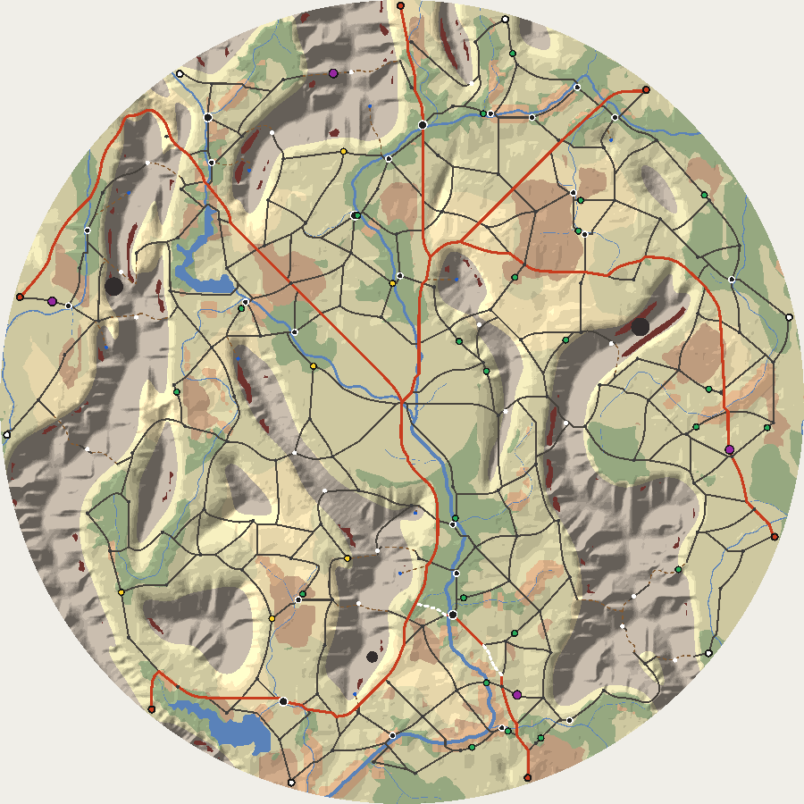
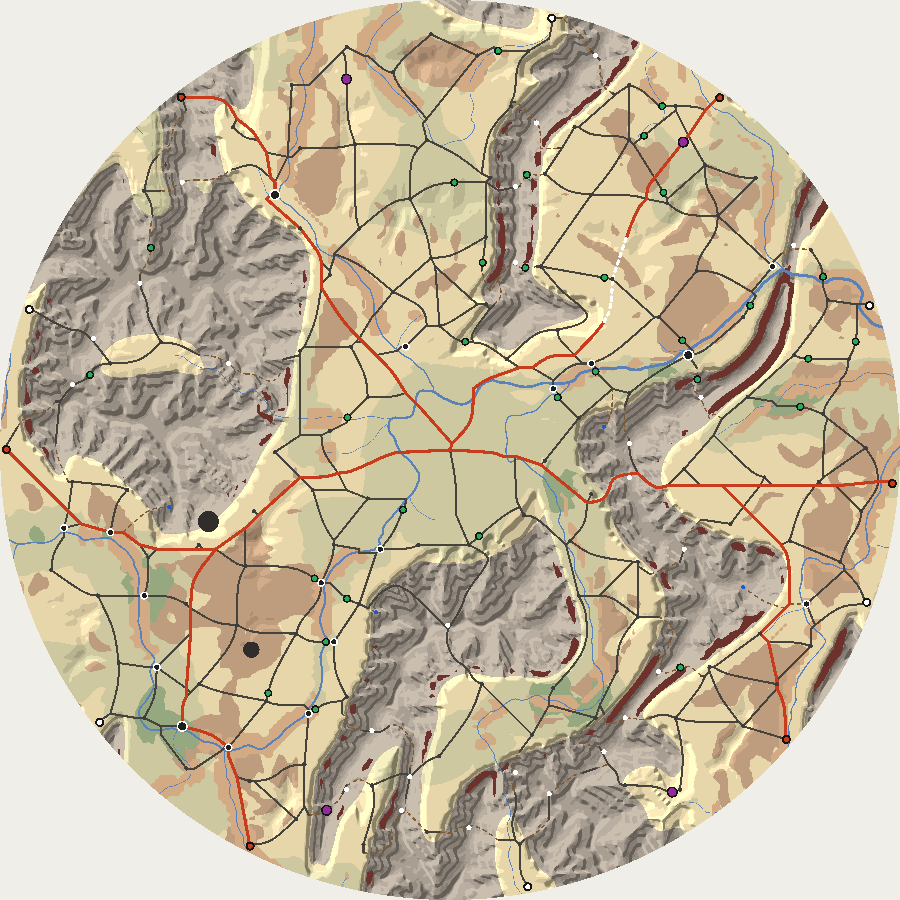
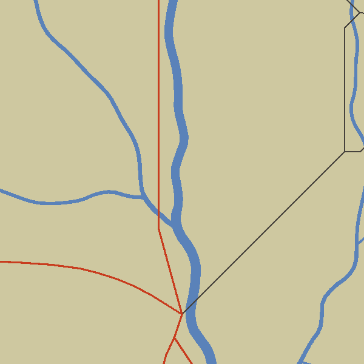
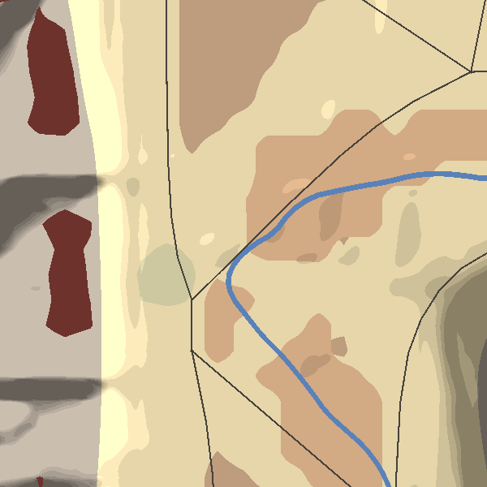

# The road network: links and the graph (DDB-443, DDB-444)

Date: 2026-10-10. Code: `_legacy/src/renderer/game/map/` (`RoadCost.ts`, the edge cost field; `RoadLinks.ts`, the links; `RoadGraph.ts`, the graph; `Roads.ts`, the stage, the loops it asks for, and broken highways; `RoadChecks.ts`; `RoadNetwork.ts`, the plain data), wired in `AreaMapPipeline.ts`, timed, swept, and drawn by `_legacy/scripts/road-network.mjs`. Spec: [Area Map Generation](../specs/Area%20Map%20Generation.md), 5. Roads, Guarantees 3, Validation and retries, and Performance. Builds Maps 7 and 8 of [realistic-map.md](./realistic-map.md), decision 2, between the places of [places.md](./places.md) over the land, water, and hazards of [water-and-biomes.md](./water-and-biomes.md) and places.md, and replaces road-growth.md's outward growth, whose `Highways.ts`, `RoadGrowth.ts`, step rules, tests, and script are gone.

## Context

The spec's roads are least-cost links between places with a detour test for loops (Galin et al.), and the prototype showed the shape: 36,000 to 47,000 units of road at radius 1000, 450 to 600 nodes, 110 to 190 loops. The route tree and POIs (route-tree-and-pois.md) were built against synthetic meshes and waited on a real network with loops, so this is what turns their strict mode on. Map 5 left four notes for it: hold both ends of a bridge step when smoothing, find bridges over the whole polyline, use a per-map edge cost field rather than `moveCost` in the search's inner loop, and test that field against `moveCost`.

Two maps at radius 1000, drawn by `_legacy/scripts/road-network.mjs png`: highways red, back roads grey, trails dashed brown, broken highway spans dashed white, towns and villages black in a white ring, crossroads small and grey, exits ringed, red on a highway, dead ends blue, passes white, and POIs green (three routes yellow, strongholds purple).

## The stage

`roads` runs after the places on `root.fork('map', m).fork('terrain', t).fork('water', w).fork('hazards', h).fork('places', p).fork('roads', r)`, over the land with its water and hazards, and draws only on named forks: `spur` at each village's id, and `broken`. Its product is `{ network, stats }`. It fails, and reruns on its next attempt, when a place has no road, when the network closes fewer loops than the POIs need (below), or on any of `checkRoadNetwork`'s rules. The POI stage escalates to it.

## The edge cost field

A move runs between two land cell centres: the eight to a neighbour, and four bridges two cells straight on (below). Each keeps the parts of its cost no class changes: its length, the grade along it, the slope across at its middle, its bridges' length factors summed, and whether it's blocked. A class weights them as `moveCost` does, so the two agree on every move the field leaves open, to 1e-12 (the test checks a fifth of a map's cells, every move, every class).

The field is stricter in two ways. A cell centre has to be open, inside the disc by half a unit and on passable ground, at both ends of a move; `moveCost` reads only the end. And a move through a square between cell centres where anything impassable could stand is sampled every half unit, blocked where a sample is impassable bar river water under one of its bridges. The samples run from the move's lower-left end (the end with the lesser x, or y where they match), whichever way a road takes it, and the network checks take a polyline's segments the same way, so a line through cell centres is sampled exactly where the field sampled its moves, and a segment cut at one of its samples is sampled where it was whole (The graph). A square's flags say what could stand there and so what to sample for: a cliff only where a corner is rough country (bilinear can't pass its corners), a lake only where a corner's depth is past -0.001, a river where its water and a unit more reach, a crater likewise, and anything beside a cell that isn't open. Asking only after what could be there, in `obstacle`'s own terms (`Terrain.cliff` is new for it), took about a quarter off the stage's time; a square only a lake could reach reads the lake's depth alone, without the river query.

The metro's rivers cost nothing to cross, and `obstacle` passes them, since its streets bridge them wherever they meet. That let the first cut drive down them: rivers lie on the flattest valley floor, so 16 of QA's 30 maps had a metro road more than 15 units in river water, 14 of them a highway, the worst 64 units down the river out of Home. Now a metro river can be crossed but not driven along. No road passes through a cell whose centre is in one, and every sample in its water has to be under one of the move's bridge spans, which `bridgeSpans` gives in the metro at any length, and free. Home's own four cells are spared, since the compound can stand in a river and its roads have to leave it. The network checks hold the same rule. Rust Belt seed 11 at radius 1200, where the north highway ran down the river out of Home, now runs beside it:

A move is worked out the first time a search asks, and kept: about 140,000 of a radius 1000 map's 393,000 are. Every part is adds, multiplies, divides, square roots, and compares, so the order searches fill it in changes nothing, which a test checks.

No road crosses a river less than 30 degrees off the river's line, in the metro or out. Before, a crossing's only limit was its bridge's length, the width over the sine of the angle, at most 24 units: a 2-unit creek could be crossed 5 degrees off its line on a deck running 25 units down it, and in the metro, where bridges have no length limit, at any angle. The field blocks such a move, `moveCost` charges it Infinity, and `bridgeSpans` gives it no deck, so where smoothing makes a line cut a bend's corner across a creek, the water there is off any deck and impassable, and the graph holds the run at the nearest cell as it does for any clip. The network checks so hold the rule as passability, which spares Home's own cells as it always has; a shallow crossing whose water happens to lie under a neighbouring steep crossing's deck would also pass them, which no map swept has shown. Eight moves a cell always leave one within 22.5 degrees of square to a straight river, so the rule costs little but a few detours where a river runs beside a road.

A broad river can leave no dry cell centre either side close enough for one step: a 9-unit river crossed square-on needs centres 9.4 apart to straddle it within 0.2 of the middle. So a road may also bridge two cells straight on, east, north, west, or south, but only over a cell whose centre is in a river, never a lake, cliff, or crater, and always sampled. They're what joins the far shore of a broad river.

## Searches

A* over the field, ties to the lower cell, bounded to an ellipse whose foci are the two places and whose distances to them sum to 1.7 times their span plus three cells; a search that finds nothing tries again 2.5 times wider. The heuristic is the straight distance at existing road's cost, 0.75 a unit (0.7 for a highway on highway), so it never overestimates. A heuristic at full cost cut expansions by a fifth and was left out, since it would miss paths that reuse road.

- Existing road costs 0.75 of the move, existing highway 0.7 to a highway, so roads merge into trunks. A cell beside a road costs 1.6 times, so a road joins another or keeps a cell clear of it.
- A move never crosses the other diagonal of its square, a road's or the search's own last two moves (a zigzag round a blocked side made one), never closes a triangle with two road moves, and a bridge two cells long never crosses another over the same cell. So two paths that cross share a cell, and the graph makes it a junction.

## Highways and back roads

Highways go first, exit by exit: to the first town in the list (best ground first) within 24 degrees of the exit's bearing and a quarter to nine tenths of the radius out, then to the compound, or straight to the compound when there's none, which a range-covered map can have.

Back roads take the Gabriel graph over every place, exits never with exits, under 0.45 of the radius, shortest first, ties by id, through grid buckets so it costs a few milliseconds. A link between places not yet joined always goes in, as a back road or, past a grade a back road can't climb, a trail. Otherwise it goes in only where the roads between its places run longer than the detour factor times its own path: 1.9 at `loops` 0 to 1.1 at 1. The roads between are a Dijkstra over road moves bounded by the factor; when it finds them within the factor of the straight span, the link is skipped without a search, since its path can't be shorter than that. Places a link still leaves cut off join the nearest road the compound reaches, by Dijkstra.

## Classes, spurs, passes

A back road gives out to a trail along a run of moves through rough country (`Terrain.rough`, the steepest 10% to 35% of the land) at least 150 units long at `trailShare` 0 to 15 at 1, 82 at the default. A move keeps the best class laid along it. Trails come to 8% or 9% of the road at the defaults.

A village takes a spur trail with chance 0.55, drawn on its own fork: toward the highest open cell 60 to 140 units off at 16 bearings, turned by a draw, 0.12 of elevation above it or more, if the trail runs 200 units or less. It ends at a dead end.

A path's highest cell is a pass where the ranges' mask is 0.5 or more there and it stands 0.05 above both ends, 30 units from any other: 11 a map at radius 1000.

## The graph

The road moves become nodes and stretches:

- Node 0 is the compound at the origin, standing on the four cells round it. Each cell keeps at most one move into them, its best class, so each of the compound's roads leaves once, along a ray to a cell 1.6 to 2.1 cells out. No two rays from the origin overlap.
- Every other node stands on a cell centre: a place's (each place stands on its own cell or the nearest open neighbour), a junction (three or more moves), a dead end, the last cell inside the metro on a road leaving it, and a class change. So no two nodes are closer than a cell, and no merging is needed. A diagonal closing a triangle with two orthogonal road moves is dropped first, handing its class on.
- Each road between two nodes is walked once. A loop back to its own node is split at its middle.
- A stretch's line is its cells, held still at its nodes and at both ends of every bridge move. Between holds, two passes of a quarter, half, quarter average take out steps back and forth between two rows (which simplifying keeps), then Douglas-Peucker at 0.6 of a cell, then two passes of Chaikin.
- Each run between holds settles on its own. A smoothed run that would be impassable, sampled every half unit with its bridges, is held at the cell nearest where it clips, and both halves are smoothed again, down to single moves if need be; so a road along a river bank stays smooth past the bend that touches the water, where the first cut dropped its whole stretch to cells and drew 45-degree stair steps (0 to 13 a map). Badlands seed 7 at radius 1000, a back road along the river's bend:

  

- A run that clashes with another falls back: to the line smoothed without the averaging, then simplified without smoothing, then its cells, which the field proved. A run out of the compound has a last level through the centre of the cell it leaves by, since the line from the origin to the next cell is no move the field proved.
- Stretches over 140 units are cut into even pieces at roadside nodes, on a point within a unit of the share or a point put on the segment there, moved off any bridge to the nearer end of its deck. A point put on a segment lands on the nearest of the segment's samples, half a unit apart from its lower-left end, or the next one off the deck. Each piece is then sampled where the whole line was, so it passes where the settled line passed. Before, a segment was sampled at even shares of its own length, and the two halves of a cut one at other points than the whole: on QA's Floodlands seed 3 at radius 900 a half's sample landed on a river sliver the whole line's had stepped over, and the stage needed a retry.
- A stretch keeps its class, length, polyline, bridges (each deck as distances along its line, merged where two crossings share one), and whether it's a city street, wholly inside the metro, charted from the start. A highway stretch carries its highway's number, its exit's order among the highway exits from 0, for the shields and the route names; where highways merge into a trunk, the trunk is the first one laid's. A stretch no longer has `parent`, and the network no longer has `roads`: the route tree holds parents, and named roads for labels are the dressing's.

## Broken highways

Highway stretches 70 units or longer whose middle lies past 0.35 of the radius, in an order shuffled on `broken`, each taken out only where every node still reaches the compound, and where it isn't the last highway stretch ending on a highway exit. They move to `network.broken`, kept for drawing with their gap. An exit's outer stretch is the furthest out, so it was often drawn, and the exit still reached the compound by a back road, so a highway exit could be left with no highway: the map said a highway left the area where none did. Now the span further in breaks instead, if it can, so the highway still collapses somewhere on its way home.

## The checks

`checkRoadNetwork` reads only the network and the land: structure (node 0 at the origin, each stretch between two different nodes and starting and ending on them, its length, its bridges in order), the disc, passability every half unit with the stretch's own bridges, the bridges matching what the line crosses, planarity and clearance by a sweep over every pair of segments in 16-unit buckets, and every node reaching the compound. Two stretches keep 2 units apart, tapering by a quarter of the distance to a node they share, and meet only at a node both end on, 20 degrees apart or more. Over 15 maps the checks take 10 ms at radius 1000. Outward, junction angles from a parent, and the tree are gone with growth.

A bridge longer than the longest has no deck, so its water fails passability; a length check on decks was dropped, since two crossings sharing a deck can run 32 units together.

## The places, and the loops they can close

The roads join every place in `placeList`'s order (places.md): the metro first, standing for the compound at node 0, then the towns, villages, crossroads, and exits. A highway exit gets its highway; a back-road exit is one more place on the Gabriel graph, never linked to another exit, so it gets a back road or a trail. Where the rim is a cliff, a lake, or a river, an exit comes in up to six cells; on 20 maps QA found each one reached under the field and every highway exit on its highway. Until the places stage landed, a stand-in threw crossroads over any open ground, mountains included, and had no villages.

The loops the POIs want are `poiDensity` times 30 plus `strongholds`, rounded up. Real places put that out of reach in the high ranges: at `mountainCoverage` 1 and radius 600 the places stage finds room for eight villages and nothing else inside the rim, and the roads close 6 loops against 34 wanted. So the stage asks for no more than the map's towns, villages, and crossroads can close, the places inside the rim a loop can run round. The first four only branch; past them, 0.3 of a loop each at `loops` 0, rising by 0.9 times `loops` to at most 0.6. With a share of every place and no allowance for the first few, another map in that corner, with 13 such places, was asked for 8 loops where its roads close 6 on every attempt, and had to restart. Over 600 rolled campaign maps the cap never bound: the fewest such places was 78, and every map's cap sat 8 or more above what it wanted. It can bind at the campaign ranges' corner (radius 800, `mountainCoverage` 0.45, `roadDensity` 0.35, `loops` 0.3, `poiDensity` 1.2, five strongholds): QA found 13 of 40 maps there capped as low as 38 against 41, though their roads close 55 to 70. Where the cap binds and the roads close fewer loops than the POIs want, no attempt can seat a stronghold in every sector either, so the POI stage holds the map leniently, strict or not, and it goes on with what it missed in the POI layer's `failures` (route-tree-and-pois.md). Where the roads close what the POIs want, capped or not, the stage stays strict and escalates, so a campaign map never loses a stronghold quietly; a test holds that at the corner.

## Measured

`node _legacy/scripts/road-network.mjs bench --radii 1000,1200`: five environments by three seeds, the whole pipeline, strict POIs, on the shared development desktop (Node 24), busy with other work:

| Radius | Roads, ms median (slowest) | Terrain | Water | Nodes | Stretches | Road, units | Loops (least) | Bridges | POIs placed | Three-route POIs | Retries |
| --- | --- | --- | --- | --- | --- | --- | --- | --- | --- | --- | --- |
| 1000 | 209 (266) | 177 | 31 | 411 | 569 | 42,737 | 156 (101) | 69 | 446 of 450, 60 strongholds | 33 | 0 of 15 |
| 1200 | 366 (405) | 285 | 41 | 596 | 808 | 59,164 | 212 (151) | 95 | 448 of 450, 60 strongholds | 37 | 0 of 15 |

The roads' time at radius 1000, profiled over six maps: A* about 50 ms, the field's moves about 90 (their samples, the grade, the slope, and river crossings), the graph about 40, the network checks 10. The places stage takes 24 ms at radius 1000 and 37 at 1200, the hazards nothing to speak of. The prototype's roads took 140 to 210 ms; the spec's grid stages budget a second on a mid-range laptop, and terrain through roads come to about 440 ms here at radius 1000 and 730 at 1200. The desktop was busier for this run than for the stand-in's, when the roads took 201 and 277 ms: terrain alone ran a fifth slower at 1000 and a third at 1200.

QA's 30 maps (five environments by seeds 3, 7, and 11 at radius 900 and 1200): no road has any river water off its bridges' decks and Home's cells, where the first cut had 3 maps past 15 units off its decks and 16 past 15 counting the decks it laid down rivers. Runs left as cells three moves or more come to 5 over the 30 maps, 0 to 2 a map, 27 on the stand-in places; the first cut left 125 whole stretches as cells, 1 to 10 a map. The levers, should a laptop need them, are the obstacle samples and the per-class cost.

`check --maps 30`, parameters sampled across their tuning ranges: every stage's first attempt passed on all 29 maps that finished, and none broke a road rule. 14 of them have places that cap the loops, 13 with `mountainCoverage` 0.6 or more and one at radius 600 asking 1.8 times the POIs and 7 strongholds; they pass with 0 to 7 of their 2 to 7 strongholds and 2 to 31 of 23 to 60 POIs, the rest in the POIs' `failures`. One gave up: Badlands at radius 1600 with `mountainCoverage` 1, whose 56 places close 33 loops, past the 22 it wants, but whose sectors' outer band holds no meeting point a stronghold can take, so the POIs escalate until the map runs out of attempts. Seating strongholds on a map that's mountains to the rim is the POI stage's to settle.

### Rivers, cuts, and exits

`road-network.mjs` counts what the three fixes are about: crossings of a river's centreline under 15 and 30 degrees off its line (bar on Home's own cells, which the compound's roads leave through any river on them), decks carrying more than 24 units of river water, the longest bridge's worth, and the most water any one deck carries, sampled every tenth of a unit; highway exits with no highway stretch ending on them; and roads retries on passability. Main and this branch, the same script, the shared desktop busy with other work:

| Run | Crossings under 15 degrees | Under 30 | Decks past 24 units of water | Wettest deck | Highway exits with no highway | Passability retries |
| --- | --- | --- | --- | --- | --- | --- |
| `check --maps 30`, main | 28 on 15 maps | 83 on 23 maps | 0 | 21.2 | 4 on 4 maps, each to a broken span | 0 |
| `check --maps 30`, now | 0 | 0 | 0 | 14.0 | 0 | 0 |
| `bench`, radius 1000, main | 18 | 57 | 2 | 34.7 | 1 | 0 |
| `bench`, radius 1000, now | 0 | 0 | 0 | 11.7 | 0 | 0 |
| `bench`, radius 1200, main | 26 | 77 | 0 | 21.1 | 2 | 0 |
| `bench`, radius 1200, now | 0 | 0 | 0 | 17.9 | 0 | 0 |

The rest barely moves. `check --maps 30`: every stage's first attempt still passes on the 29 maps that finish, none breaks a road rule, and the Badlands map at radius 1600 still gives up in the POIs. `bench`, main then now: at radius 1000 the roads take 185 ms median (210 slowest) and 193 (248), with 42,737 and 42,745 units of road, 156 loops either way (least 101), and 69 bridges then 65; at radius 1200, 249 (282) and 260 (281), 59,164 and 59,169 units, 212 loops (least 151), and 95 bridges then 90. Terrain ran 151 and 152 ms at radius 1000 and 213 and 218 at 1200 in the same runs, so the roads are about as fast as they were. POIs, strongholds, and retries are the same, bar a three-route POI more or less. QA's Floodlands seed 3 at radius 900, whose roads needed a retry on main when a cut's samples found a river sliver, passes first time.

## Determinism

The tests pin two maps' networks as hashes of every node and stretch point, computed in a separate Node process from the Jest run that checks them, and check that the same stream makes the same network and another stream another.

## Roads in the C++ alpha

`libs/rules/map/` (2026-10-30 and 31, DDB-571) is the pipeline's fifth stage, on `...fork("places", p).fork("roads", r)`, forked `links`, `spur` (by village id), `broken`, and `numbers`, with this record's numbers and provisional calls 1 to 17, 19, 20, and 21. `EdgeCostField` is the cost of every move, `RoadSearch` the searches, `RoadLinks` the links as moves on the land grid, `RoadGraph` the nodes and stretches drawn from them, `RoadChecks` the network checks, and `Roads` the stage, which breaks the highway spans and holds the network to the checks. Its product is `Roads::network()`, nodes, stretches, broken spans, passes, and route numbers, with the moves it was drawn from beside it. What differs:

- The field is `MoveCost`'s parts, not a copy of its arithmetic. `MoveCost` splits a move's cost into what no class changes (`parts`: the length, the grade, the slope across, the bridges, whether it's bridged, and what stands at its middle) and what a class makes of them (`weigh`), and the field calls both, so the two agree to the bit wherever the field leaves a move open, taken the way the field files it, where the TypeScript's agreed to 1e-12; a test checks every fifth cell's moves for every class. The field hands `parts` its cells' own elevations rather than sampling them again, and keeps each class's cost once a move is worked out, since the searches ask for a move about ten times over.
- A square's flags are exact per obstacle: a cliff only where the land's open squares say one could stand (rough and steep at once, neither past its largest corner), where the TypeScript flagged any rough corner; a lake where a corner is past -0.001; rivers and craters by their boxes and a unit more. The flag for anything beside a cell that isn't open is gone. A move's two open ends lie inside the disc, which is convex, and the four flags already cover every obstacle there is, so all it did was make moves along a river bank or a cliff ask every sample everything. A bridge two cells long still asks everything. On a radius 600 map in a Debug build, the exact flags took the links from about 430 ms to 300.
- The Gabriel links are taken shortest first give or take a tenth of their span, drawn on the `links` fork, ties by id, so a roads retry links the places in another order, as Validation and retries says it does. The TypeScript's retry redrew only the spurs and the broken spans, so a stage short of loops failed the same way eight times over before the map restarted.
- Dropping a diagonal that closes a triangle with two road moves, and leaving each cell beside the compound one move into it, happen as the links finish rather than in the graph, and moves between the compound's own cells go there too. So the graph reads nothing but the moves and the ground: no cost field, and since `bridgeSpans` is now a function of the ground alone, which every class bridges alike, no `MoveCost` either.
- The stage fails on a place no road reaches, on fewer loops than `loopsNeeded` once the broken spans are out, and on any rule `checkRoadNetwork` finds broken, each problem named by its rule ("passable: stretch 12 is impassable..."), as map-pipeline-worker.md's call 3 has it.
- Where runs clash, they fall back in order of their stretch and their place along it, not the order the sweep found the clashes in: either is deterministic, and this one doesn't hang on the sweep's buckets.
- A node's place is -1 on a node that's no place, and a stretch's highway number -1 on any other class.
- Each highway's route number, the one its shields and its routes' names carry, is the network's (`routeNumbers`, by highway), drawn on the stage's `numbers` fork: 2 to 99, none twice, every number shuffled and the first taken. The TypeScript's dressing drew them; stops-and-routes.md, Route descriptors in the C++ alpha, has why they moved. The structure check holds every highway to one, in range, and no two to the same.
- The arithmetic the rivers and the roads share is `Polyline`: Chaikin, Douglas-Peucker, and lengths along a line, moved out of `Rivers.cpp` unchanged, with points along a line and the segment distances and meetings the checks use.
- `Places` lists every place in id order (`placeList`), the metro at the origin first, which is what the roads read.
- The searches pop from `NodeHeap` (2026-10-31), a min-heap keyed by cost with ties to the lower cell, moved out of `RoadSearch` so the route tree and the dressing's rails pop from the same one. It pops the order `RoadSearch`'s own heap did, so no road moved.

Measured in RelWithDebInfo, the whole pipeline, five environments by seeds 3, 7, and 11, on the shared development desktop busy with other work. Loops are the network's after its spans break, and the most any map needed was 34. A run is left as cells where neither a smoothed nor a simplified line would pass or keep clear:

| Radius | Roads, ms median (slowest) | Nodes | Stretches | Road, units | Loops (least) | Bridges | Runs left as cells, a map | Retries |
| --- | --- | --- | --- | --- | --- | --- | --- | --- |
| 1000 | 157 (189) | 328 to 479 | 430 to 696 | 32,179 to 48,742 | 95 to 218 (95) | 42 to 84 | 0 to 4 | 0 of 15 |
| 1200 | 262 (272) | 463 to 645 | 592 to 943 | 45,362 to 68,095 | 130 to 299 (130) | 63 to 112 | 0 to 4 | 0 of 15 |

Every map passed on its first attempt, the network checks included. The links alone took 113 ms median at radius 1000, so the graph, the broken spans, and the checks come to about 45. The prototype's roads took 209 ms median there, with 411 nodes, 569 stretches, 42,737 units, and 156 loops (least 101). The field works out about 139,000 of a radius 1000 map's 393,000 moves, as the TypeScript did. Only one run in the 30 maps is a stair step of three moves or more. The spec's sizes at radius 1000 (450 to 600 nodes, 560 to 770 stretches) are the prototype's, and this comes in under them on most maps.

Tests hold, on three maps: every place reached, a highway from every highway exit, and the loops the POIs need; no move over an obstacle or an unbridged river, sampled asking everything, nor a highway or back road up a grade past 1.1; the moves planar on the grid, each filed once, none between the compound's own cells, and one into it at most from each cell beside it; the network keeping every rule `checkRoadNetwork` has; node 0 the compound, every other node but a roadside point on its own cell centre, and each marked by what happens there; stretches no longer than 140 units and a few cells, streets just those inside the metro, a highway's number on each highway stretch for each highway exit; and broken spans far enough out and long enough, planar with the rest. Then: spurs that end at dead ends; a highway's cheapest path from each town to the compound taking less climb than a trail's, each the cheapest for its own class; the field agreeing with `MoveCost` to the bit, bridging two cells only over a cell centre in a river, the same in whatever order it's asked, and crossing a metro river free but never along it; the checks finding each rule broken on networks laid by hand in the metro, with a river planted where a test needs one; a long line cut only on its own samples, and off a bridge to its deck's nearer end; the last highway out of a highway exit never breaking, the span further in breaking instead; more loops at `loops` 1 and a larger share of trail at `trailShare` 1; the pipeline's roads the ones built straight from their stream; and a roads retry leaving the earlier stages on their first streams, with other roads.

## Consequences

- `RoadNetwork` is `{ nodes, stretches, broken, passes }`; a node has an optional `place`, and a stretch `length`, `bridges`, and `street`, without `road` or `parent`. The worker packs stretches' points as before and sends broken spans and passes by structured clone.
- The area map view draws an uncharted stretch as a stub from whichever end a charted or rumored stretch ends on, or the compound, and a junction dot where any stretch there is drawn solid, since there are no parents to ask. Knowledge per leg is DDB-294's.
- `polylineLength` and `pointAlong` live in `Geometry.ts`, for the roads, the route tree, and the POIs alike.
- The roads read the places stage's `placeList`, the metro as the compound; the stand-in places are gone. `RoadStats` counts the towns, villages, and crossroads (`inland`) for the loops rule.
- The POI stage is strict (route-tree-and-pois.md), bar maps whose places cap the loops and whose roads close fewer than the POIs want, and the gallery's area map scenes move with every road.
- `roads` in place of `growth` takes `AREA_MAP_GENERATOR_VERSION` to 4, so a save whose map version 3 made reads as outdated; `CampaignMaps.test.ts` pins the stage list, the menu labels the stage, and the save fixture names it. A change to any number here moves every map, so it goes with another bump: the least crossing angle, the samples from a segment's lower-left end, and the exits' highways take it from 5 to 6, with the pin and the save fixture.
- New Campaign founds through the whole pipeline, so the roads run at founding. Over 100 rolled campaign seeds none gave up or needed a retry, no map's loops were capped, and every map seated all its strongholds: the pipeline took 420 ms median, 703 at the slowest, the roads 190.

## Provisional calls

Calls the spec and realistic-map.md left to the build, made the simplest way consistent with them, for Kevin to approve or adjust:

1. Moves between land cell centres, eight ways, plus a bridge two cells straight on over a cell whose centre is in a river.
2. Cell centres half a unit inside the rim; a move through a square where anything impassable could stand sampled every half unit.
3. Searches bounded to an ellipse 1.7 times a link's span plus three cells, widened 2.5 times when that finds nothing; an admissible heuristic at existing road's cost.
4. Existing road at 0.75 of new ground, existing highway at 0.7 to a highway, ground beside a road at 1.6 (realistic-map.md's 13, with the highway's own).
5. Highways through the first town in the list within 24 degrees of the exit's bearing, a quarter to nine tenths of the radius out.
6. Gabriel links under 0.45 of the radius, the test's circle 0.92 of the diametral one's area, exits never linked to exits.
7. The detour factor 1.9 at `loops` 0 to 1.1 at 1 (realistic-map.md's 13); links within it of their straight span skipped unsearched.
8. A back road becomes a trail along a run through rough country 150 units long at `trailShare` 0 to 15 at 1.
9. Spurs: chance 0.55 a village, the highest open cell 60 to 140 units off at 16 bearings, 0.12 of elevation up, at most 200 units of trail.
10. Passes: a path's highest cell in the ranges (mask 0.5), 0.05 above both ends, 30 units apart.
11. Geometry: two quarter-half-quarter passes, Douglas-Peucker at 0.6 of a cell, two Chaikin passes; a run that clips something held at the cell nearest and both halves smoothed again; a run that clashes falling back to unaveraged, then simplified, then cells.
12. Stretches cut at 140 units; clearance 2 units, tapering by a quarter toward a shared node; stretches meet at nodes 20 degrees apart or more.
13. The compound stands on its four cells, with one move into them from each cell, and its roads leave it through any river on them.
14. Broken highways: stretches 70 units or longer with their middle past 0.35 of the radius.
15. The roads stage fails below `poiDensity` times 30 plus `strongholds` loops, rounded up, or below what the map's towns, villages, and crossroads can close where that's fewer: none for the first four, then 0.3 of a loop each at `loops` 0, rising by 0.9 times `loops` to at most 0.6.
16. The metro's rivers are crossed, free and on a bridge of any length, never driven along: no road through a cell centre in one, and no sample in one off a bridge's deck.
17. A highway stretch's number is its exit's order among the highway exits; a trunk takes the first laid's.
18. Where the places cap the loops (15) and the roads close fewer than the POIs want, the POI stage holds the map leniently, strict or not.
19. No road crosses a river less than 30 degrees off its line, in the metro or out, bar on Home's own cells, where the compound's roads leave through any river on them (13).
20. A broken highway span is never the last highway stretch ending on a highway exit.
21. The Gabriel links taken in order of their span nudged up to a tenth either way on the roads stream's `links` fork, ties by id, so another attempt links the places in another order.
