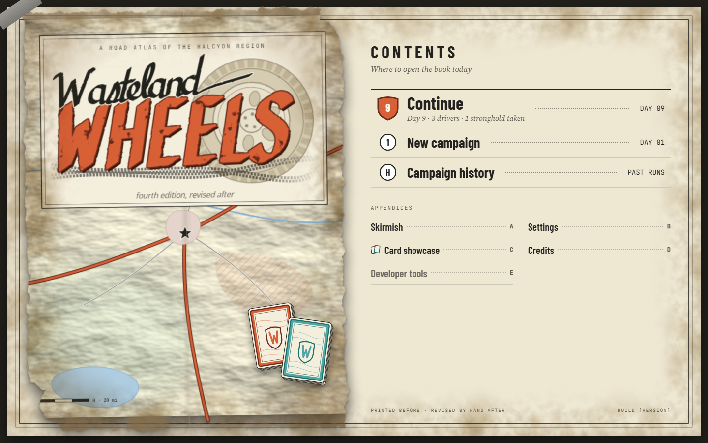
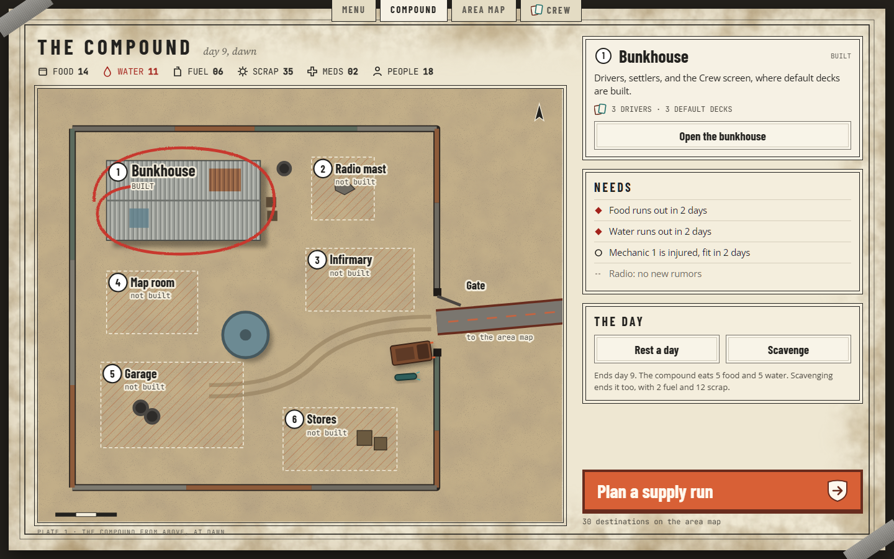
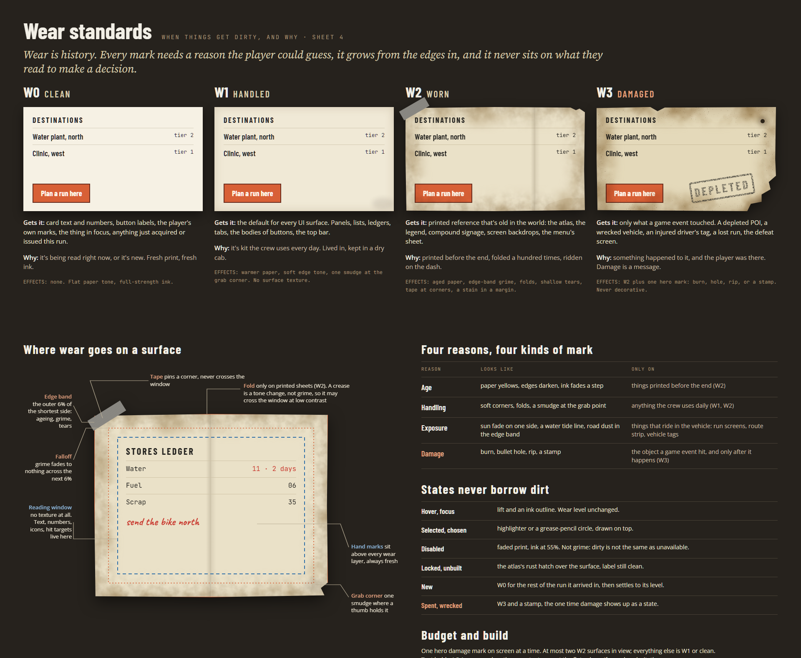
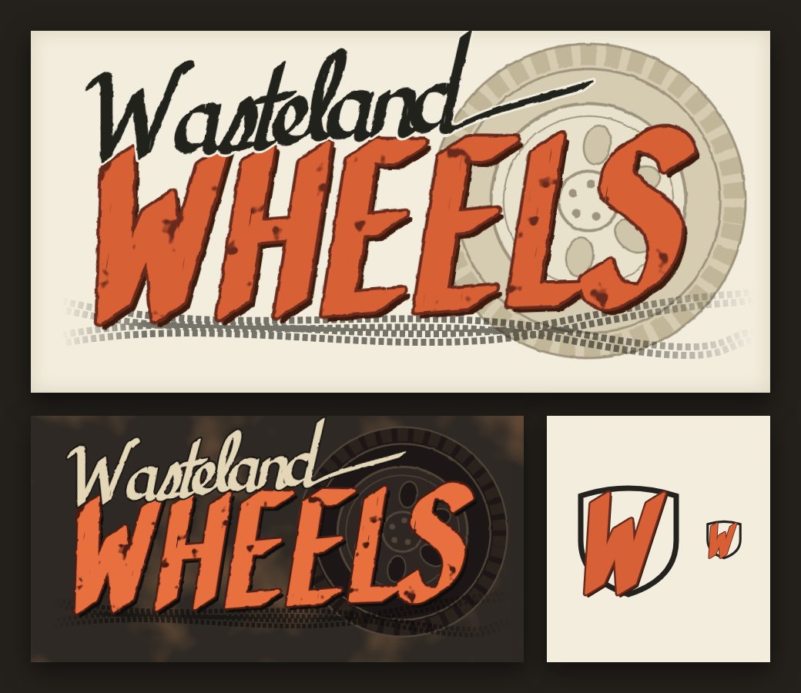
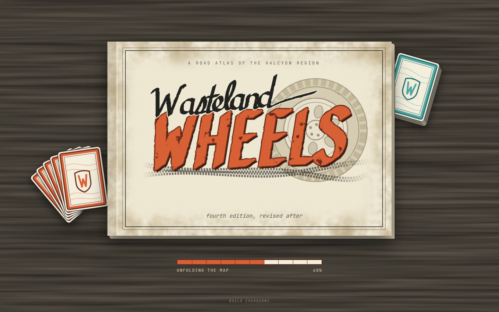

# UI Art Direction

Status: working direction for the first playtest, set 2026-10-16, not built. It isn't the final UI; expect another pass once the playtest says what reads and what doesn't. Design canvas: "Wasteland Wheels UI Concept" (https://claude.ai/artifact/7xA6GgX1ErZyduCWRnpPfi), playtest row. Renders of those boards, and of the mood board they came from (`mood-board.png`), are in `docs/design/ui-art-direction/`. The canvas sources are checked in at `docs/design/ui-art-direction/canvas/`, and the directions and mood boards that weren't chosen are rendered in `exploration/`. Decision record: [ui-art-direction.md](../AI_TECHNICAL_DECISIONS/ui-art-direction.md). The map side of this look is already built: [area-map-atlas-style.md](../AI_TECHNICAL_DECISIONS/area-map-atlas-style.md).

The game's UI is the crew's road atlas. It was printed before the end, folded a hundred times, and revised by hand after. Everything the game tells the player is printed on the page: names, numbers, panels, buttons. Everything the player decides is drawn on top by hand, in highlighter and grease pencil. Those two layers, print and hand, are the whole system, and they carry the look the area map already has out into every screen around it.

## Scope

In: the launch splash, the main menu, the compound, the area map's side panel, the run route panel, the crew and load-out screens, customize, campaign history, settings, credits, and the result screens.

Out: the combat screen, which gets its own deeper visual pass later, and card faces, which belong to the card spec. Nothing here should be read as a rule for either until those passes say so.

## Palette

Every colour comes from the atlas or from the hand that marks it. There's no glow, no gradient wash, and no colour that doesn't have a reason on a road map.

| Name | Hex | Where it's used |
| --- | --- | --- |
| Table | `#24211C` | The dark ground the sheet lies on, seen only in the 14 px margin |
| Sheet | `#EEE7D2` | The screen's page (W2) |
| Paper | `#F4EEDD` | Legend boxes and panels (W1) |
| Fresh paper | `#F6F1E4` | The thing in focus, anything just issued (W0) |
| Index | `#E4DCC4` | Inactive tabs, wells, inputs |
| Ink | `#23221F` | Text, rules, borders, map symbols |
| Ink dim | `#5D5A52` | Secondary text, captions, kickers |
| Ink faint | `#6E6A61` | Tertiary text, empty states |
| Faded print | `#8E8778` | Disabled text only |
| Highway | `#D86036` | The one primary action per screen, driver A |
| Casing | `#682C1E` | The highway's border, its pressed offset |
| Back road | `#76726A` | Secondary button borders, minor lines |
| River | `#3E6F98` | Read-only information, water, flavor text |
| Route teal | `#4FA6A3` on `#1F6E6A` | Driver B, fill on casing |
| Stronghold | `#A3221B` | Warnings, hostile places, shortfalls |
| Sage ink | `#4F6B3A` | Good news (status ok) |
| Rust hatch | `#B5643C` | Locked, unbuilt, contaminated |
| Built-up | `#E5D4CC` | Built footprints on plans and plates |
| Highlighter | `#F4DA4C` | The player's selection |
| Grease pencil | `#C8372D` | The player's marks on plates and maps |
| Duct tape | `#85837D` | Tape holding sheets down (art only) |

Contrast, measured on the flat colours: ink on paper 13.7:1, ink dim on the sheet 5.6:1, ink faint on paper 4.7:1, stronghold on paper 6.5:1, river on paper 4.6:1, ink on highlighter 11.4:1. Paper-coloured text on highway is 3.5:1, which passes only for large text, so labels on highway orange are display bold at 18.66 px or more and nothing smaller ever sits on it. Wear is measured too (see Wear).

### Tokens

The palette lands in `tokens.json` (R11.1) as a second theme, `atlas`, beside the current dark one. The leaf names stay as they are (R11.4); only values change, plus a few additions.

| Token | Atlas value |
| --- | --- |
| `bg_void` | Table |
| `bg_base` | Sheet |
| `bg_inset` | Index |
| `bg_panel` | Paper |
| `bg_panel_raised` | Fresh paper |
| `bg_hover` | Ink at 4.5% |
| `bg_active`, `bg_selection` | Highlighter at 35% and 55% |
| `bg_pressed` | Ink at 10% |
| `line_hairline`, `line_edge`, `line_strong` | Ink at 14%, 40%, 90% |
| `accent`, `accent_bright`, `accent_dim`, `accent_contrast` | Highway, `#E8703F`, Casing, `#FFF8EE` |
| `accent_glow`, `data_glow` | Transparent: the atlas marks active things with ink and highlighter, never light |
| `data`, `data_bright`, `data_dim` | River, `#86AED3`, `#AFCDE1` |
| `text_bright`, `text`, `text_dim`, `text_faint`, `text_disabled` | `#141311`, Ink, Ink dim, Ink faint, Faded print |
| `status_ok`, `status_warn`, `status_crit`, `status_info` | Sage ink, Highway, Stronghold, River |
| `scrim` | Table at 60% |
| `shadow`, `shadow_strong` | `#140F0A` at 50% and 75% |
| `radius_ui`, `radius_panel` | `r_0`: the atlas is square-cornered |

Additions: `driver_a`, `driver_a_casing`, `driver_b`, `driver_b_casing`, `hand_highlighter`, `hand_grease`, `hatch_rust`, `built_up`, `back_road`, `duct_tape`, and `sheet_margin` (14 px); and `accent_edge` (Casing) and `focus_ring` (Ink), which the dark theme aliases to its accent.

## Type

The three roles of R11.8 stay and keep their faces; they're the faces the area map already sets its labels in.

| Role | Face | Use |
| --- | --- | --- |
| display | Barlow Condensed | Screen titles in spaced capitals (700, 0.16 em, 32 to 34 px), section heads (700, 0.16 em, 20 px), place names and button labels (700, 18 to 30 px) |
| body | Open Sans | Descriptions and needs (400, 14 to 15 px over 1.45), emphasis (600) |
| mono | JetBrains Mono | Counts, ledgers, kickers, captions (400 and 500, 10 to 14 px, kickers at 0.14 em) |

Two weights are missing from the current atlases and need generating: Barlow Condensed 700 and Open Sans 600.

Two optional roles are phase two, because each needs its own MSDF atlas (R6.4) and `msdf-atlas-gen`: `serif` (Source Serif 4 Italic) for water names, flavor lines, and subtitles like "day 9, dawn", which the cartographic convention sets in italic; and `hand` (Caveat 700) for the player's written notes. Until they exist, subtitles set in body and the game writes no notes. All five faces are OFL.

Labels that sit on art (a plate, the map) get a paper halo: the existing shadow run in the paper colour at zero offset and 2.2 px blur (R6.6), as the area map does.

## Wear

Wear is history. Every mark needs a reason the player could guess, it grows from the edges in, and it never sits on what they read to make a decision.

| Level | Gets it | Why | Effects |
| --- | --- | --- | --- |
| W0, clean | Card text and numbers, button labels, the player's marks, the thing in focus, anything just acquired | It's being read now, or it's new | None: flat paper tone, full-strength ink |
| W1, handled | The default for every UI surface: panels, lists, ledgers, tabs, button bodies | Kit the crew uses daily | Warmer paper, a soft edge tone, one smudge at the grab corner, no surface texture |
| W2, worn | Printed reference that's old in the world: the screen sheet, the atlas, compound signage, backdrops | Printed before the end, folded, ridden on the dash | Aged paper, edge-band grime, folds, shallow tears, tape at corners, a margin stain |
| W3, damaged | Only what a game event touched: a depleted POI, a wrecked vehicle, an injured driver's tag, a lost run, defeat | Something happened to it and the player was there | W2 plus one hero mark: a burn, a hole, a rip, or a stamp |

Where wear goes on a surface:

- The edge band is the outer 6% of the surface's shorter side; grime fades to nothing across the next 6%.
- Inside that is the reading window, with no texture at all. Text, numbers, icons, and hit targets live there.
- Folds appear only on W2 sheets. A crease is a tone change, not grime, so it may cross the window at low contrast.
- Tape pins a corner and never crosses the window.
- Hand marks sit above every wear layer and are always fresh.

The reasons decide the kind of mark: age yellows the paper and fades the ink a step (W2 only); handling softens corners and leaves a smudge where a thumb holds it; exposure fades one side, leaves a tide line, and dusts the edge band (things that ride in the vehicle: the route strip, vehicle tags); damage burns, holes, rips, or stamps, and only after the event.

States never borrow dirt:

- Hover and focus lift the element and add an ink outline. The wear level doesn't change.
- Selected is highlighter, or a grease-pencil circle on a plate.
- Disabled is faded print, ink at 55%, with a dashed border. Dirty is not the same as unavailable.
- Locked and unbuilt get the rust hatch over the surface; the label stays clean.
- New is W0 for the rest of the run it arrived in, then settles to its level.
- Spent and wrecked are W3 plus a stamp, the one time damage reads as a state.

Budget, per screen: one hero damage mark at a time; at most two W2 surfaces in view, everything else W1 or clean; text holds 4.5:1 measured on the worn texture, not the flat colour, and if wear breaks it the wear moves; elements under 120 px on their short side get no texture, only edge tone.

Wear can carry state over a campaign: the atlas yellows a step every few days, and a driver's tag picks up a tear per injury. That's optional and comes after the base look.

## Components

The screen sheet. Every in-scope screen is one W2 sheet on the table with a 14 px margin, a double neatline (0.6 px outer, 1.6 px inner, 8 px apart), and duct tape at two opposite corners. It's the screen's only W2 surface unless a plate is on it.

Section tabs. Navigation between the meta screens is a row of thumb-index tabs hanging from the sheet's top edge: display 700 at 15 px and 0.14 em. The active tab is fresh paper and 4 px taller; the others are index colour with ink-dim labels. This replaces "Back" buttons between sibling screens.

Legend box, the panel. Paper (W1) with a 1.4 px ink border and a 0.6 px inner rule inset 6 px, 16 to 18 px padding, a display 700 spaced-capital head, rows split by hairlines. Map-legend symbols lead rows where they help: a stronghold diamond for a shortfall, an open ring for a pending item, a dashed line for nothing to report.

Buttons.

- Primary is the highway: Highway fill, a 4 px Casing border, a 3 px Casing offset beneath for depth, the label in display 700 at 28 to 30 px in `#FFF8EE`, and an optional shield glyph at the right. One per screen.
- Secondary is the back road: Fresh paper fill, a 1.6 px Back road border, and a 1 px inner rule inset 3 px. Display 700 at 18 to 19 px in ink.
- Hover: the border goes to ink and the button lifts 1 px. Pressed: the offset collapses and it sits 3 px lower. Focus visible: a 2 px ink outline 3 px out. Disabled: faded print and a dashed border.
- Minimum hit size 44 px.

Resource strip. Stores read like a map's legend key: an 18 px stroke icon, the name in mono capitals, the value in mono 500. A shortfall turns the item stronghold red, with a body line under the strip naming it ("Water and food run out in 2 days"). The stroke icons are baked into the UI art atlas at 1x and 2x and tinted ink, since the MSDF icon atlas builds from a font ([ui-art-atlas.md](../AI_TECHNICAL_DECISIONS/ui-art-atlas.md)).

Contents rows. Lists of destinations, menu entries, and history use the atlas's contents page: a leading glyph, the label in display 700, dotted leaders, and a mono value at the right. Numbered things use the map's circled glyph, ink on white; the primary row's glyph is a highway shield.

Markers and counters, from the map: circled letters for places and numbered items, a highway shield for counters (the day, a route number), a stronghold diamond for anything hostile, the star for home.

Gauges. Stores and other countable supplies use the scale bar: alternating ink and paper segments in a 1.2 px ink frame. Continuous values use a cased bar, the driver's colour on its casing.

Plates. Illustrated views, the compound first, are framed as atlas plates: a 1.6 px ink rule with a 0.6 px rule 4 px outside it, and a mono caption below ("PLATE 1 · THE COMPOUND FROM ABOVE, AT DAWN"). Plate art is top-down, lit from the north-west like the map's hill shade (azimuth 300), with shadows offset to the south-east. Buildings that exist are drawn; unbuilt plots are staked out with string lines over the rust hatch. Places on a plate are labelled the way the map labels them: a circled number and a halo label, with the state in mono beneath.

The hand. Highlighter marks the player's selection in lists and on plans. A grease-pencil loop circles the selected thing on a plate. Each mark is baked art with three or four variants, so two selections never match, drawn above everything at W0. A hand mark is never the only signal: the selected item also shows in the panel it drives (the compound's "selected building" box) or carries an outline.

Card hints. It's a card game, and the UI says so quietly in many places rather than loudly in one. The motif is the crew's two decks, one per driver, living alongside the atlas.

- The card back is atlas stock at 5:7 with 7 px corners: an ink edge, a band in the driver's colour on its casing (Highway for deck A, Route teal for deck B), a fine inner rule, faint contour lines, and the small mark's W in a shield at the centre. It's a back only; card faces stay with the card spec.
- Decks appear as physical objects where the scene has room for them: two small stacks set down on the menu cover, two decks on the table beside the atlas on the splash. A stack shows three or four card edges under its top card, with the sheet's drop shadow.
- The deck glyph, two overlapping card outlines in the two casing colours, marks anything about decks: the Crew tab, the bunkhouse's "3 drivers · 3 default decks" line, the Card showcase entry. It's a UI art atlas entry at 20 by 18 px, baked in its two colours.
- Rules: at most two deck objects on a screen, never over a reading window or a control; deck objects are W1 (handled, never damaged); A is always orange and B always teal, so the pair reads as the two drivers wherever it shows up.

Logo. `docs/design/ui-art-direction/logo.svg`: "Wasteland" in a broad-nib ink script over "WHEELS" in sign-painted brush capitals (Highway on a Casing outline with a drop shadow and chipped paint), two tire tracks beneath, and a large inked wheel behind the right half. It's hand-drawn letterwork with no font in it. It ships as a baked texture in the UI atlas at 1x and 2x, not as runtime SVG. Use it on the menu cover and the splash; on dark grounds use the reversed variant on the logo sheet. The small mark, the painted W in a highway shield, is the app icon and favicon.

## Screens

Launch splash. The closed atlas lies on the table: the cover sheet (W2) with its neatline, a spine shadow on the left, and page edges showing along the right and bottom. The logo fills the cover between "A road atlas of the Halcyon region" and "fourth edition, revised after". Deck A lies fanned at the lower left and deck B stacked at the upper right, both partly under the book. Below it the loader is a scale bar, ten segments filling in Highway on a Casing frame, captioned "UNFOLDING THE MAP" with the percentage in mono. The build number sits at the bottom. It fades in, holds, and hands off to the main menu as the current splash does.

Main menu. The left half is the atlas cover: a relief map with the logo in a cartouche ("A road atlas of the Halcyon region"). The right half is the contents page. When a campaign is in progress Continue is the primary row, a highway shield with the day number in it and the save's summary in its subtitle. Otherwise New campaign is primary and Continue stays in its place as faded print, its subtitle saying why there's nothing to continue (no campaign, a damaged save, an older save format), as [Game Flow and UI Specification](./Game%20Flow%20and%20UI%20Specification.md) 1.1 describes. Campaign history follows, then the appendices (settings, card showcase, credits, developer tools in dev builds, and Exit game in Electron) in a two-column list. The two decks sit on the cover's lower right, set down on the map.

Compound. The left two thirds is the compound plate, an overhead view of the yard. The right column holds, top to bottom, the selected building's legend box (name, state, description, its action), Needs, The day (rest or scavenge, with what each costs), and the primary action, Plan a supply run, pinned to the bottom. The title, the day, and the resource strip sit above the plate.

Area map and run route. The map is already in this style. Its side panel, which the atlas-style record kept dark, moves onto the sheet as a column of legend boxes, the destinations as contents rows, and Plan a run here as the primary.

The rest (crew, load-out, customize, campaign history, settings, credits, results) follow the same parts: one sheet, tabs, legend boxes, contents rows, one highway button. Result screens are where W3 earns its place: a defeat is a burnt sheet, a looted POI gets its stamp.

## Building it

- All texture is baked. The canvas mocks use SVG turbulence filters to stand in for paper, grime, relief, and brush edges; in game those are nine-sliced paper textures in the UI art atlas (R5.19, R5.31), one set per wear level with the wear in the corner and edge slices and a flat centre the shader tints. Wear is seeded per object and never animates or reshuffles between frames.
- New art in the UI atlas ([ui-art-atlas.md](../AI_TECHNICAL_DECISIONS/ui-art-atlas.md)): paper nine-slices for W1, W2, and W3 in two or three variants each, tape strips, hand marks, stamps, the compound plate, the logo and small mark, the two card backs and a card edge, the closed-atlas cover for the splash, and the resource, section, and deck icons.
- Keep one GPU draw per flush (R5.20). Highlighter is baked as a normal-blend tone, not drawn with the `multiply` blend mode, because every multiply draw is a blend change and splits the submission.
- Square corners everywhere: the theme re-aliases `radius_ui` and `radius_panel` to zero (R11.7), no component edits.
- The combat screen keeps the current dark theme until its own pass. Each screen selects its theme (open question 1): a meta screen opts into `atlas`, and a screen that doesn't stays dark. The mechanism is in [theme-selection.md](../AI_TECHNICAL_DECISIONS/theme-selection.md).

## Open questions

1. Theme scope. Decided: per-screen theme selection, so the meta screens go atlas while combat stays dark, rather than re-theming globally and changing combat before its pass.
2. The compound plate. Decided: vector shapes built in engine (flat, rect, and circle draws, with the corrugated roofs as stripes rather than a texture), drawn from the buildings the campaign holds, so a building appears on the plate the day it's built. A painted bitmap per compound state was the alternative.
3. When the `serif` and `hand` roles land, and whether the game writes its own hand notes (rumors, warnings) or leaves the hand layer to the player's choices only.
